# WIP: Bevy 0.20.0 stable and headless widgets

**Draft only. Human manual verification is required before adoption or merge.**
This exploration originally started from remote `main` at
`736758f291289ff2bb1942a0405027b44e919997`. Current main already includes Bevy
`=0.20.0` stable, so the remaining PR change is the opt-in headless widget
prototype. It is not qualified for release. No human UI passes or broad
qualification-ledger changes are claimed by this PR.

The visual acceptance criterion is a comparable appearance and an intact
workflow. Minor differences are acceptable when they do not obscure state,
change command meaning, clip required content, or prevent an existing action.
Pixel identity is useful evidence, but is not an adoption requirement.

Latest focused follow-up: [large Settings dragging and affected workflows
pass on clean `93541949`](#large-settings-drag-resolution-2026-10-18). Bevy still
owns picking and dialog gestures, with two small documented dependency
corrections. The existing appearance is preserved; this is not an unmodified
Bevy dependency claim.

## Why headless widgets

Bevy's headless widgets supply behavior without a visual theme. Keep the current
`ViewportUiTheme`, retained nodes, glyphs, control sizes, spacing, localization
and layout. Feathers has useful editor controls, but adopting its default
appearance would require an additional design/parity pass.

| Control | WIP implementation | Remaining adoption work |
| --- | --- | --- |
| Shared buttons and menu items | `bevy::ui_widgets::Button`, `Pressed`, `Activate` | Manual mouse, keyboard, focus and modal parity |
| Shared boolean checkboxes/toggles | `Checkbox`, `Checked`, `ValueChange<bool>` | Manual command-state and accessibility parity |
| Text, dimension and script fields | Existing Bevy `EditableText` plus native adapters | Preserve ordered editor flush, AltGr/Option, IME ownership and multiline behavior before using `TextInput` directly |
| Sliders/ranges | Standard `Slider`, `SliderThumb`, `SliderStep`, `SliderPrecision` and controlled `SliderValue` | Step-index conversion retains CAD `f64` values; oversized/invalid ranges retain the native adapter. Current source/live checks recorded below. |
| Shared feature dropdowns | Standard `MenuButton`, `MenuPopup` and `MenuItem` over the existing inline choice layout | Existing form reducer owns open/selected state. Other cycling choice fields remain native; no separate popup framework was added. |
| Radio groups and tabs | Standard `RadioGroup`/`RadioButton` and `TabList`/`Tab` | Settings, feature and sketch-origin radios; Assembly tabs. Document tabs keep native navigation after the standard-tab trial failed focus continuity. |
| Dialogs and scrolling | Standard dialog title dragging, two small dependency corrections, and the existing shared resize adapter | Large Settings and shared Extrude move/resize workflows pass; host-window resizing and other forms retain their separate qualification limits. |
| Orientation dial and CAD annotations | Existing custom visual/geometry controls | Product-specific controls need their current geometry and hit behavior |

## Input and state ownership

The temporary `experimental-ui-widgets` Cargo feature changes the migrated
control behavior listed above in the real native host. It does not start a second document
controller or create a second UI. Build/run a scratch document for manual review:

```sh
cargo run --locked --manifest-path desktop/Cargo.toml --features experimental-ui-widgets
```

The reworked experiment leaves Bevy's standard picking pipeline enabled. Its UI
backend chooses the control, `Button`/`Checkbox` recognize primary pointer and
keyboard activation, `Hovered`/`Pressed` drive the existing theme, and
`InputFocus` plus Bevy's `TabNavigation` API own focus. A Bevy `GhostNode` holds
the Tab group while leaving the retained UI roots in their original layout. Decorative checkbox squares,
checks and labels are not separate pick targets. The previous `WidgetInput`,
`adapt_input`, `adapt_actions` and synthetic pointer/focused-key events are gone.
The native host bypasses its click recognizer and activation-key path for these
controls; it does not activate the same control a second time.

Tab requests use the native host's existing per-event modifier snapshot with
Bevy's `NavAction::Next` / `Previous`. The automatic Tab plugin reads final
batch key state and failed reverse traversal in the macOS check. This keeps
Bevy's traversal algorithm while preserving Shift on the original event.

The application still chooses eligible controls and Tab order, blocks controls
outside the active modal, and distinguishes primary UI input from CAD secondary
clicks and camera gestures. Published document/binding stamps accompany Bevy's
`Activate`/`ValueChange` notifications into the existing command reducer. A
document change cancels pending pointer state; rebinding or disabling an
unrelated control no longer cancels a dialog-owned gesture. Native text edits are
flushed before queued widget commands are reduced. These are CAD ownership and
transaction responsibilities, not a second widget event implementation. With the
experiment enabled, the Bevy window runner processes pending motion and each
primary-button transition before accepting later motion. This preserves Bevy
picking targets when native events arrive in one batch; see the
[small runner extension](../desktop/vendor/bevy_winit/LIMO-PATCH.md).

Checkbox state remains controlled by accepted application commands. Some
checkboxes perform commands such as Fix/Unfix, so a value proposal preserves the
command intent and `Checked` is projected from the accepted state. Text editing, cycling choice fields outside shared feature forms,
document strips and ordinary menus retain their existing adapters. The flag keeps the old default available as the
visual/workflow baseline during this draft experiment.

Migrated controls retain their real Bevy accessibility nodes. The native
projection supplies their localized labels, bounds and command bindings on
those same entities, instead of creating duplicate proxy controls or deleting
Bevy's nodes. Unmigrated controls still use their existing accessibility
projection. Screen-reader behavior remains a separate acceptance item.

The 2026-10-16 results below describe the earlier guarded adapter. They are
historical evidence, not passes for this standard-input rework. The separate
rework checks below use clean builds with PR433 and PR434 locally integrated;
the broad qualification ledger remains paused.

## Standard-input rework, 2026-10-17

PR420 source `8b0051f4` replaces the guarded adapter with standard Bevy picking,
button/checkbox activation, hover/press state, and focus navigation. The local
validation branch combines main `49dec66d`, PR433 `5cde5c0d`, and PR434 `fcbde1b7`.
The dependencies are not included in PR420's published branch.

Fresh native macOS checks on clean integration `62e3572f` verified File/Settings,
light and dark themes, Chinese labels at 125%, scrolling, pointer/Space settings
toggles, two-profile Merge extrusion, 12 mm field editing and single Apply,
earlier-sketch editing, Undo/Redo, save/reopen, and canceling an edited feature.
The saved schema-15 model is exactly equal to the default baseline's model.
The Snap square now toggles successfully; the existing focus retirement after
changing Snap remains, so a subsequent Space does not toggle it until focus is
reacquired. This was an unresolved baseline limitation at that revision; the
[latest follow-up](#settings-dragging-and-snap-focus-follow-up) fixes and verifies it.

Thirteen capture pairs are retained with raw differences and revision identities.
The controls retain comparable labels, layout and sizing. Some pairs have
intentionally different selected settings, preview distances, camera positions,
focus, or browser expansion; those pairs are layout comparisons, not pixel
identity claims. The reopened Extrude dialog differs by 62 pixels within its
640-by-1252-pixel region. Checkbox glyph/focus differences do not block the tested
workflows.

Three regressions were found and repaired: a non-UI focus parent excluded roots
from layout (use Bevy's `GhostNode`); widget input partitioning could consume an
existing native drag release (preserve its current owner); and Shift+Tab moved
forward on macOS (pass the native event's modifiers to Bevy's `TabNavigation`).
Final integration `5ebe37bc` passed strict library/test Clippy, 98 interface tests,
13 native-host tests, and the release package build. Live native input then
verified reverse Tab in Settings, focus across native fields and Bevy controls,
Space activation, release outside Finish Sketch followed by a normal click,
and canvas/slider drags released over buttons. The slider stayed active through
release without closing Settings; subsequent Reset and Close clicks worked.
After editing/canceling and finishing the sketch, the saved model still matches
the default baseline byte for byte. The scoped result is **12 passed behavior
cases and one shared Snap focus issue**, with no pending affected rechecks.


MCP was used only for matched-build inspection and image capture. All modeling
input used the user-authorized native app automation. No scripts, replay,
raw inbox writes, or MCP mutations were used. The broad qualification ledger
remains paused; this is a focused comparison, not complete UI or screen-reader
qualification. The feature remains opt-in and the PR remains draft.

See [rework evidence](qualification/bevy-widgets-standard-input-20261017.json).

## Movable and resizable dialogs

With `experimental-ui-widgets`, Settings and the shared solid-feature panels
(Extrude, Revolve, Sweep, Loft, Fillet, Chamfer, Hole, patterns and the other
forms using that panel) can be moved by their title bar and resized from the
bottom-right corner. Position and size last for the open dialog; reopening
starts from its usual placement. The dialog stays inside the client window,
including after changing interface scale or window size.

Bevy's `Dialog`, `DialogDragHandle` and `DialogPlugin` recognize title dragging
and retain pointer ownership. One shared adapter adds a resize handle using
Bevy `PointerDrag`, enforces readable minimum sizes, and keeps CAD's existing
modal layer order. Existing panel painters use the resulting size, preserving
scrolling and Apply/Cancel. Canvas dimension fields remain anchored to geometry.
There is no separate pointer-event recognizer, docking system or saved window
manager. Other bespoke panels and native operating-system file choosers retain
their existing behavior.

The focused source checks pass: 101 interface tests, seven Settings tests,
strict release checks, and a clean V8 macOS build (`3a688963`) with PR433 and
PR434 locally integrated. Real GUI startup exposed duplicate `DialogPlugin`
registration in V7; `bafaf561` reuses the plugin installed by Bevy and adds a
regression test.

Eleven focused live cases passed: Settings movement/resizing, scrolling,
forward/reverse Tab, 125% scaling and default geometry on reopening; Extrude
draft/annotation preservation, scrolling and Cancel; Revolve boundary/minimum
width and validation; apply/undo/save; and operation after disk cleanup. Applying
14 mm from a moved Extrude dialog worked. Undo and Save restored the original
12 mm model byte-for-byte.

At this historical V8 checkpoint, some large Settings drags dismissed the
dialog or focused a different control. Ordinary moves and resizes passed, but
exact minimum height and host-window resizing were unrun. The
[2026-10-18 follow-up](#large-settings-drag-resolution-2026-10-18) resolves the
large-drag issue and verifies Settings minimum dimensions. Host-window resizing
remains outside that focused run. Native host CI was still running at V8.
See [dialog evidence](qualification/bevy-dialogs-20261017.json).

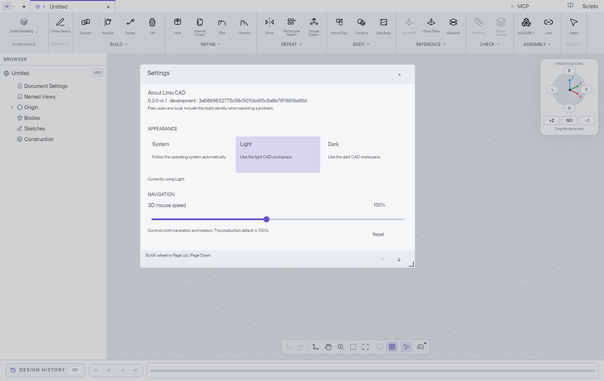

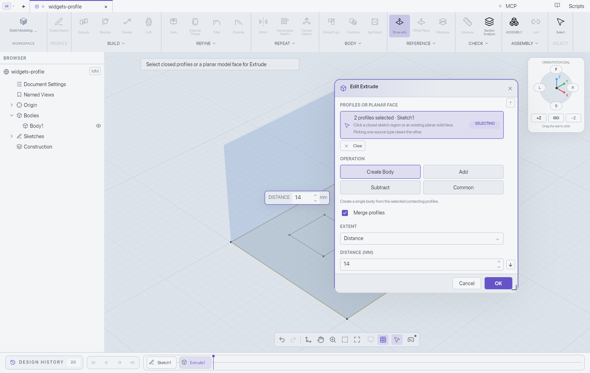

## Rebase onto merged dependencies

PR420 was rebased onto main `5303f9a1` after PR433 and PR434 merged. Its patch
is byte-identical to the pre-rebase patch; formatting and locked manifest
checks pass. The final dependency versions add profile and history fixes
beyond the V8 test snapshot. V8 captures remain historical evidence; the
Extrude apply/undo/save flow needs a targeted recheck on the new combined build.
The large-drag issue and unrun boundary cases remained open at that checkpoint.
The later resolution is recorded below; this rebase checkpoint itself performs
no new live UI or MCP qualification. See the
[rebase record](qualification/bevy-rebase-20261017.json).

## Stable dependency and window-host patch

The desktop pins `bevy`, `bevy_ecs`, `bevy_gizmos` and `bevy_reflect` to
`=0.20.0`; the desktop lockfile resolves the Bevy family to stable versions.
Stable also advances Bevy's WESL dependencies to 0.6.0, requiring native render
verification in addition to compilation.

The published stable `bevy_winit` source files are identical to rc.2. Refresh
the normalized stable manifest and archive provenance, preserving the existing
service-wake patch: explicit wakes advance schedules without an OS redraw.
The later Settings repair adds an opt-in primary-button update boundary to this
runner and a press-origin correction to the standard dialog widget. Both
regressions must pass when refreshing dependencies. See the
[runner patch](../desktop/vendor/bevy_winit/LIMO-PATCH.md) and
[dialog patch](../desktop/vendor/bevy_ui_widgets/LIMO-PATCH.md).

## Source checks

```sh
cargo check --locked --manifest-path desktop/Cargo.toml --all-targets
cargo check --locked --manifest-path desktop/Cargo.toml --all-targets --features experimental-ui-widgets
cargo test --locked --manifest-path desktop/Cargo.toml --lib --features experimental-ui-widgets native_viewport::interface_shell -- --test-threads=1
cargo test --locked --manifest-path desktop/Cargo.toml -p bevy_winit explicit_service_wakes_advance_app_without_os_redraw_and_return_to_idle -- --test-threads=1
cargo test --locked --manifest-path desktop/Cargo.toml --test bevy_020_widgets
```

The existing native-host CI additionally runs the focused widget regressions
with the experiment enabled on Linux, macOS and Windows. Source/headless checks
do not establish visual or physical UI parity.

Local macOS source validation on 2026-10-14 passed both all-target compile
checks, the CI all-target/all-feature Clippy check, 96 distinct native-interface
regressions across scoped runs, the explicit-wake regression and all three
stable text-widget characterization probes. The windowless native GPU
UI/compositing regression also passed. These results leave the human checklist
below outstanding; they do not qualify supported platform packages or full
custom-shader coverage.

## Focused integration check, 2026-10-16

The resumed comparison uses clean integration revision `da44953a`, combining
main `49dec66d`, the updated PR433 head `5cde5c0d`, PR434 `fcbde1b7`, and PR420
code checkpoint `21e0ef5d`. The dependencies remain locally merged only; they
are not included in PR420's published diff. The earlier initial-window run at
`1e393585` used PR433 `467fe8b9` and is preserved as historical evidence.

Jack authorized native macOS app automation for this focused comparison.
Two separately signed, self-contained Apple silicon apps were built from the
same clean integration revision, with the widget feature disabled and enabled.
Both load bundled OCCT 8.0.1. Native pointer and keyboard input exercised isolated
scratch documents; MCP only inspected and captured their state. The matched
client size was 1360 × 860 logical pixels, at 200% display scale.

The scoped run records **11 passed behavior cases, one shared baseline issue,
and 13 paired visual states**. No new widget regression was observed in these
cases. This is not full UI qualification or human adoption acceptance.

| Exercised behavior | Observed result |
| --- | --- |
| File menu and Settings | Matching labels, icons, disabled entries and single activation |
| Light/English/100%; dark/Chinese/125% | Comparable sizing, selection, focus and translated labels; lower settings remain reachable by scrolling |
| Settings boolean toggle | Pointer switches it off; Space switches it on, verified in the accepted control state |
| Two sketch regions and Merge profiles | Center and ring select independently; merging previews one combined volume |
| Distance edit and Apply | 12 mm is committed before one extrusion is added; one body and two total history features |
| Earlier sketch edit | Later extrusion disappears from the canvas while Sketch1 is edited, then returns on Finish |
| Release outside Finish Sketch | Widget build stays in sketch mode; the canceled gesture does not finish it |
| Undo/Redo and save/reopen | Body and history restore; both saved schema-15 model payloads are exactly equal |
| Feature edit and Cancel | Two profiles, Merge and 12 mm persist; canceling a flipped preview restores the original body |
| Snap palette row/square | Shared issue described below; not counted as a functional pass |

The primary modeling captures match after accounting for different fixture
names and a two-pixel-high history-track line. Settings and File menu captures have
different empty-grid positions; their controls have matching bounds and state.
The reopened feature dialogs are pixel-identical. Additional differences are
confined to the header, browser expansion and history track after the differing
inspection sequences.
Raw pixel differences and capture hashes are retained, rather than described
as a universal pixel-identity pass.


**Shared baseline observation:** in both apps, clicking the displayed Snap
square did nothing, while clicking its row toggled it. After the row toggled,
inspection reported no focused control and Space did not toggle it. Snap was
restored in both fixtures. This historical case remains recorded as an issue,
not a retroactive pass. The [latest follow-up](#settings-dragging-and-snap-focus-follow-up)
fixes the remaining focus loss and verifies square clicking and Space.

The updated PR433 integration passed two profile-selection migration tests and
five native OCCT region tests. The earlier integration passed all 97 native
interface tests, including seven widget cases, and the native GPU compositing
regression. Their revisions are recorded separately. Those source checks are
not substitutes for the native interaction evidence.

Live Revolve, the complete control catalog, held-key/re-entry/deactivation edge
cases, full focus traversal, IME, screen readers, other display densities and
Windows/Linux visual checks remain untested in this scope. Native file-chooser
automation needed deliberate key presses on one retry; the verified path opened
successfully afterward. Neither that automation behavior nor earlier window
enumeration failures are attributed to a locked Mac or a product defect.

The [focused evidence record](qualification/bevy-widgets-20261016.json) includes
expected/actual results, build hashes, fixture paths, captures, unresolved
observations and explicit exclusions. The broad UI/MCP ledger remains paused
and unchanged. The feature stays opt-in and this PR stays draft.

## Required human manual verification

Compare the same scratch fixture on stable/default and stable/experiment at
matched window size and display/interface scale. Record
build identity, expected versus actual behavior and screenshots where useful.
Do not reuse previous qualification passes as evidence for changed controls.

- [ ] Light/dark themes, localization, 100%/200% display and interface scaling:
      labels, glyphs, dimensions, spacing, hover, selected/pressed/disabled
      colors, focus rings, clipping and tooltip placement remain comparable. Minor
      differences are acceptable if the workflow remains intact.
- [ ] Toolbar, ribbon, dialog and menu buttons activate exactly once on release;
      dragging outside, releasing outside, window deactivation and cancellation
      do not activate. Re-entry while captured matches the baseline.
- [ ] Checkboxes and command toggles reflect accepted state, including rejected
      operations. Rapid repeated clicks and double-click behavior match.
- [ ] Tab/Shift-Tab, Enter/Space, held-key repeat, modified activation keys,
      context menus and menu navigation match. Bevy buttons suppress repeated
      key activation; verify whether that differs from the baseline and resolve
      any difference before adoption.
- [ ] Opening/replacing a modal, switching/reopening a document, reusing a row,
      hiding/disabling a pressed control and model work in progress cannot
      activate a replacement target or leak input into the canvas.
- [ ] Text edits commit in the original event order before button activation;
      dimensions, script editing, clipboard, AltGr/Option and Japanese/Chinese
      IME remain correct through focus and document changes.
- [ ] Existing sliders, range precision/rounding, previews, dropdowns, tabs,
      scrolling, Undo/Redo and save/reopen behave as before.
- [ ] Screen-reader names, roles, checked/disabled state, tab order and activation
      are correct with no duplicate controls or stale focus.
- [ ] CAD rendering, custom WESL shaders, native GPU stock, resizing, occlusion,
      idle service wakes and owned-frame presentation work on supported platforms.

Keep the PR draft/WIP until a human records these results and explicitly accepts
the scoped parity. Broad UI/MCP qualification remains governed by the existing
paused ledger and is not resumed by this exploration.


## Standard sliders, choices, radio groups and tabs

This follow-up remains behind `experimental-ui-widgets`. Sliders use Bevy's
pointer capture, drag and keyboard implementation. The existing theme paints
the track and thumb; the thumb is two pixels larger to match Bevy's measured
travel with the existing eight-pixel inset. The widget range is expressed in
step indices, then converted back to the CAD field's `f64` origin and step.
Nonfinite or more-than-1,048,576-step ranges keep the existing adapter.

Settings theme/language/scale, shared feature radios and sketch-origin radios
use `RadioButton`/`RadioGroup`. Assembly tabs use `Tab`/`TabList` with automatic
selection. Document tabs keep the native strip, including navigation to hidden
tabs and double-click renaming. The standard document-tab trial exposed a focus
lifetime issue; replacing that path would need more custom handling than this
migration permits.

The shared feature forms retain their inline dropdown appearance and use
`MenuButton`, `MenuPopup` and `MenuItem` for input, navigation, dismissal and
focus return. Application code connects menu events to the existing form
reducer and prevents a completed selection from toggling the list open again.
Choice fields elsewhere that currently cycle values retain their existing
behavior. That control-migration checkpoint added no widget dependency patch
or alternate pointer recognizer. The later Settings repair makes the two small
dependency corrections documented below.

The focused native-interface, Settings, document and host checks passed: 215
distinct checks, including the standard-widget input schedules and native
document-tab input ownership. Strict release Clippy and formatting checks passed.

Clean native macOS build `54c6a644` passed the Settings slider's track click,
drag/release outside and keyboard endpoints; radio selection by pointer/arrows;
production Tab/Shift+Tab traversal; English/Chinese, light/dark and 125% Settings;
feature-menu pointer/keyboard selection and Escape; feature radios; and Assembly
tab selection and disabled-state checks. Extrude Apply, Undo, Redo, save/reopen
and Cancel preserved the expected model. The saved `model.json` after Undo is
exactly equal to the original fixture, and after Cancel to the applied model.
This also completes the targeted Extrude recheck requested by the rebase record.

The standard document-tab trial retained click, rename and close, but document
switching cleared focus and broke consecutive arrow navigation. One small focus
repair passed its source fixture and still failed in the clean native build
`b9f1a556`. Final source `881ef366` therefore keeps all document tabs on their
original native path and removes the document-specific focus and double-click
adapters. The document-tab painter is byte-identical to the pre-migration source.
The final fallback has routing/source checks; no new live fallback pass is
claimed. Assembly tabs continue using Bevy's standard `Tab`/`TabList` directly.

Eight focused live behavior cases remain qualified for the adopted controls.
The document click case is historical and the document-arrow trial is recorded
as failed, not counted as a pass. This keeps the migration bounded instead of
adding more custom focus machinery.

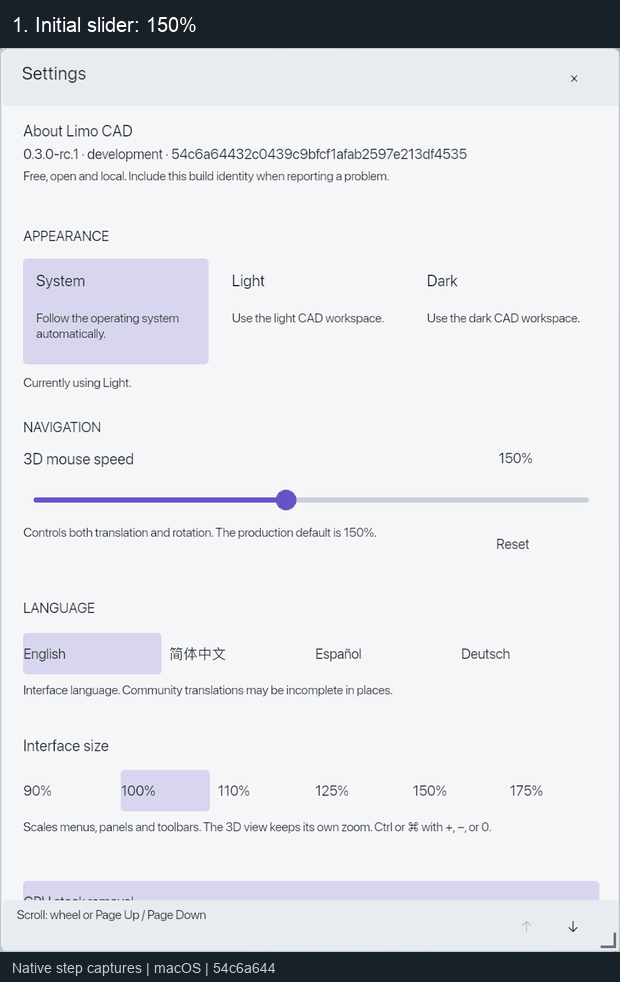

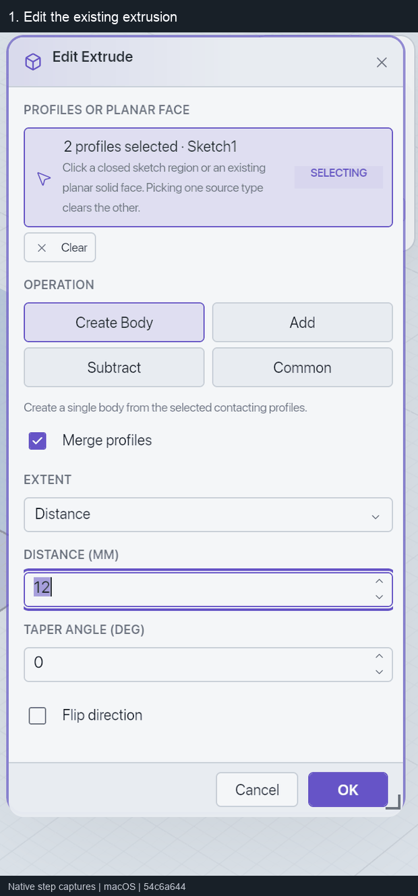

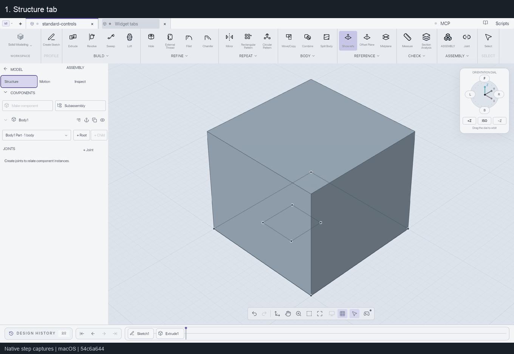

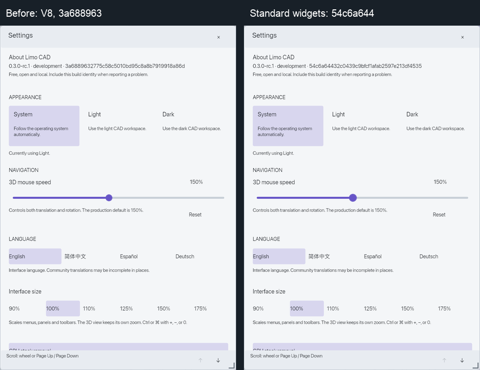

The GIFs are labeled sequences of native step captures, not real-time recordings.
The Settings comparison uses historical V8 `3a688963` beside `54c6a644`; layout
and theme remain comparable, with a slightly larger slider thumb. All live input
used the native app, with matched clean read-only MCP inspection/capture. No MCP
mutations or broad ledger changes were made. Other platforms, every feature form,
long dropdown lists and full screen-reader behavior remain unqualified. The prior
large Settings drag issue was still open at this checkpoint; both it and Snap
focus have later focused resolution records below.
See the [focused evidence record](qualification/bevy-controls-20261017.json),
[input model](qualification/bevy-controls-20261017/standard-controls-input.limo)
and [applied model](qualification/bevy-controls-20261017/standard-controls-applied.limo).


## Settings dragging and Snap focus follow-up

This 2026-10-17 record is historical. Its Snap passes remain tied to `46ecca2a`;
the large Settings blocker is resolved in the next section.

Clean native macOS build `46ecca2a` fixes Snap focus through the temporary disabled
state used while a command runs. It keeps the existing Bevy `InputFocus` and
`InteractionDisabled` behavior: disabled controls cannot activate, while an
existing focus resumes when the control becomes available. Hidden, removed,
modal-covered and replaced-document targets still retire. There is no
Snap-specific restoration or second keyboard handler.

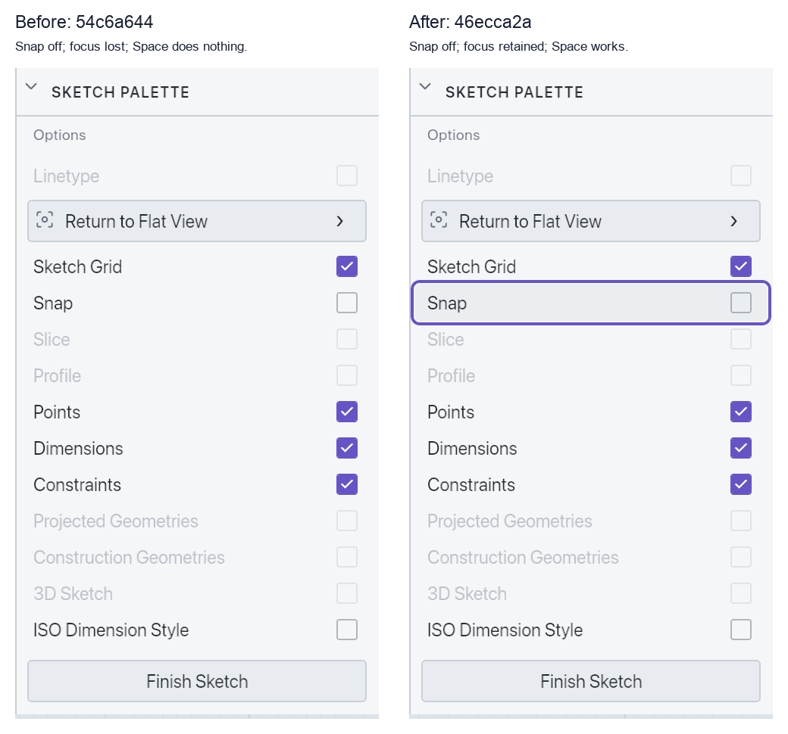

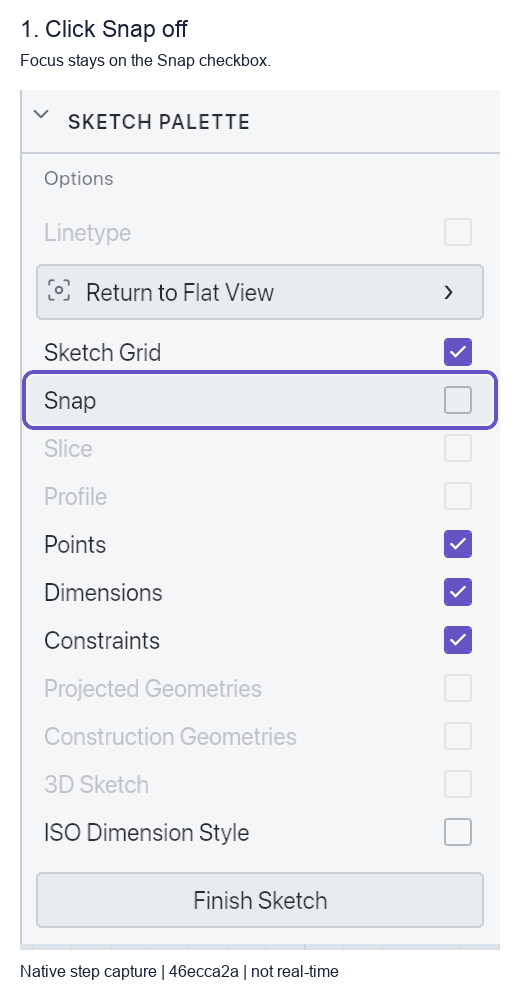

Five focused live cases passed: clicking the displayed Snap square and Space;
production Tab/Shift+Tab and subsequent Space; Finish Sketch; dependent
Undo/Redo; and save, close and reopen. In this fixture Tab moves from Snap to
Constraint 2: horizontal; Shift+Tab returns to Snap. The saved `model.json` is
byte-identical to the input fixture, and editing the reopened sketch shows Snap
on. The palette layout remains comparable, with a visible retained focus ring.
These GIFs are labeled native step captures, not real-time recordings.

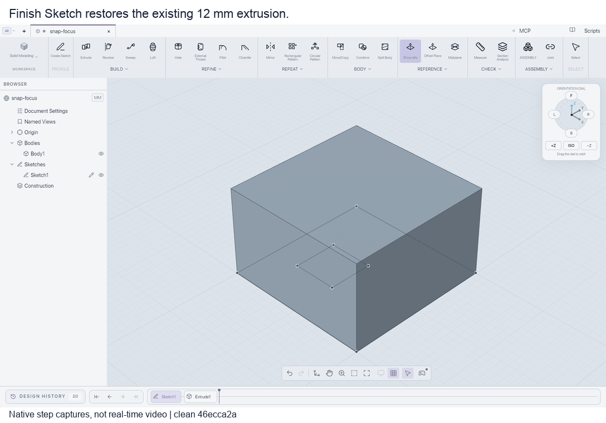

The small dialog repair uses Bevy's existing press/drag ownership, including
child targets such as slider thumbs. A clipped or disabled sibling no longer
clears a dialog-owned pointer gesture. The regression exercises the actual
Bevy event schedules and dialog plugin, but **large native Settings drags
still failed at this checkpoint**. On clean trial `a76749a7`, dragging the title from screenshot (1150,270)
to (550,270), with and without a prior title click, left the dialog unchanged
and focused its backdrop. The standard 60 Hz reactive-update trial did not help
and was removed in `46ecca2a`.

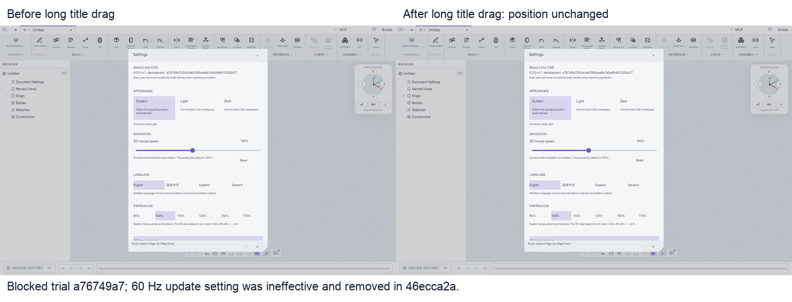

The initial investigation stopped at the repository's two-cycle/30-minute
limit. Its next hypothesis was native event batching versus final-position
hit selection; that was not yet proven. The user explicitly authorized
extending this investigation on 2026-10-18. The new traces and resolution below
supersede the blocker without changing these historical test results. No extra
pointer recognizer or replay queue was added; the later repair does include two
small dependency corrections.

All 129 focused checks passed on `46ecca2a`: 109 native-interface, 13 native-host
and seven Settings tests, plus strict release Clippy and formatting. The new
regressions cover disabled-focus retention/activation gating and unrelated-control
changes during standard dialog dragging. The clean packaged GUI and read-only
MCP builds match. Broad UI/MCP coverage stays paused; there were no MCP mutations.
PR420 remains draft and the widget feature remains opt-in.

See the [focused evidence record](qualification/bevy-settings-snap-20261017.json)
and [saved fixture](qualification/bevy-settings-snap-20261017/snap-focus-saved.limo).


## Large Settings drag resolution, 2026-10-18

Clean native macOS build `93541949` passes large and repeated Settings title
drags, all four client-window edges, the previously failing large corner resize,
400×260 minimum size, enlargement, scrolling, 125% scale, keyboard focus and
close/reopen. No accidental language changes or dialog dismissal occurred in
the final run. The user explicitly authorized extending the initial repair cap.

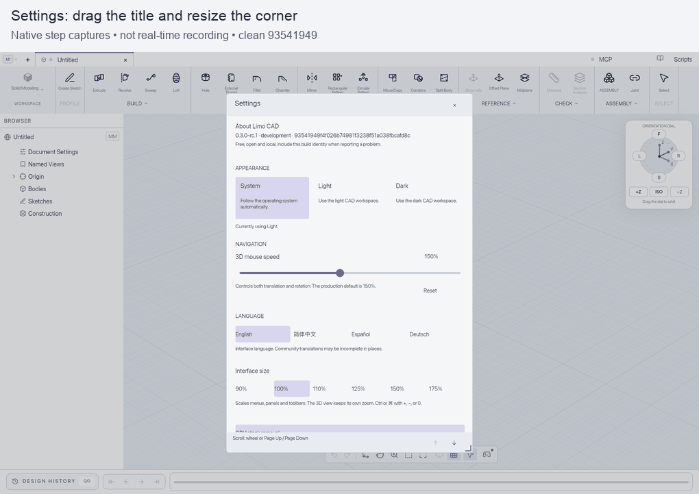

These are native step captures, not real-time recordings. The centered Settings
crop is pixel-identical to the preceding clean `a9dc5ee6` build outside its About
build-identity line; the displayed comparison is unmasked. This compares the
runner correction, not a fresh full default-versus-experiment qualification.

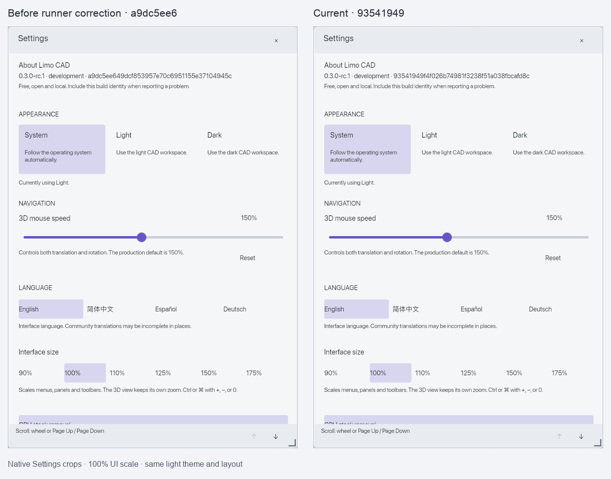

Two native traces isolated independent causes:

- Bevy's dialog stored the first movement position as the drag origin, while
  drag distance was measured from the press. Large first movements were clamped
  incorrectly. `a9dc5ee6` initializes the same standard `DialogDragState` on
  `PointerPress`. All other widget source files remain identical to published
  Bevy 0.20.0; picking, capture, translation and clamping remain Bevy's.
- A press and later movement could arrive in one batch. Bevy's documented
  final-hover behavior then targeted the backdrop or a radio at the later
  location. `93541949` adds an opt-in boundary in the existing window runner:
  process pending movement, then the primary-button transition, before later
  motion. This uses ordinary app schedules and keeps the existing Bevy picking
  and widgets. There is no custom hit test, gesture recognizer, event queue or
  idle timer. It adds bounded schedule work on button transitions; no zero-cost
  or broad performance claim is made.

The earlier origin-only V14 build still had intermittent corner misses and a
language change. V15 tracing reproduced backdrop targeting. Those failed trials
remain investigation evidence; the final product has no diagnostic tracing.
See the [dialog patch](../desktop/vendor/bevy_ui_widgets/LIMO-PATCH.md),
[runner patch](../desktop/vendor/bevy_winit/LIMO-PATCH.md), and
[focused evidence record](qualification/bevy-settings-drag-20261018.json).

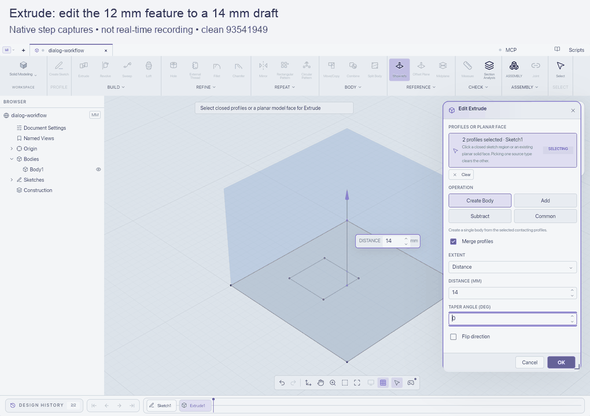

Ten affected native cases pass. Slider drag, Reset and release outside remain
correct. The resized Extrude form retains its 14 mm draft; dropdown Escape
returns focus, and Cancel/reopen restores 12 mm. Apply from the moved form,
Undo/Redo and save/reopen preserve the expected model. Snap click/Space retains
focus; production Tab moves to Constraint 2: horizontal and Shift+Tab returns
to Snap. The final saved model is byte-identical to the starting fixture with
12 mm extrusion and Snap enabled. A separate settled Save was used after Undo;
the initial combined Undo/Save arrived before asynchronous Undo finished.

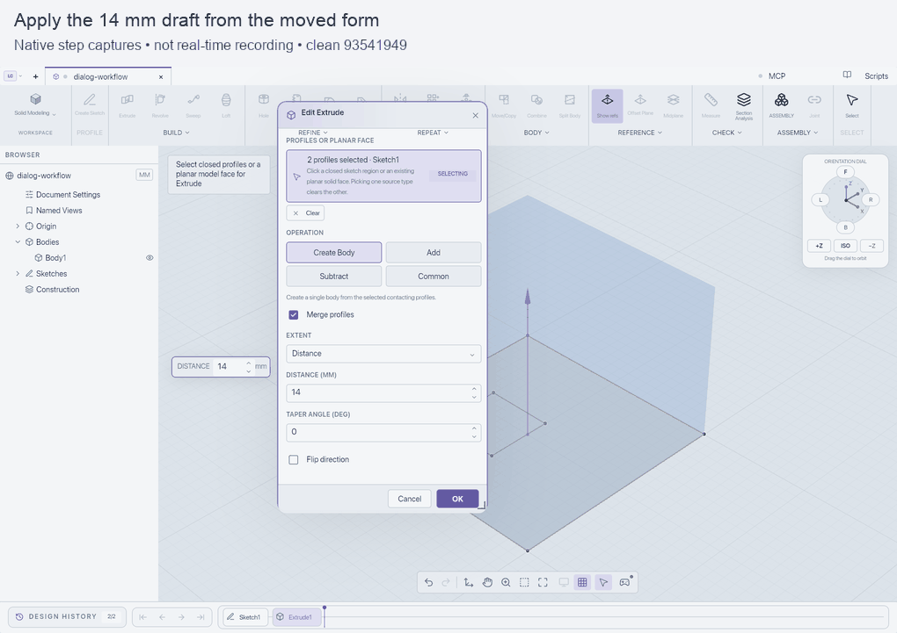

The shared feature form retains its translucent body: ribbon text can show
behind it when dragged over the ribbon. Required fields remained readable and
usable; this change does not alter its painter. Other platforms, host-window
resize, every tool/form, full tab order, screen readers and IME remain outside
this focused run. No product copy changed; current native scope is English,
light theme and 100%/125% interface scale.

All 132 focused source checks pass: 110 interface, 13 native-host, seven Settings
and two runner tests. Strict release Clippy passes for the app and patched
runner, along with formatting. All 36 native receipts have clean matched
GUI/MCP identities and presented/submitted frames. Broad UI/MCP qualification
stays paused; MCP was read-only. The PR remains draft and the feature opt-in
while broader human/platform verification and CI remain separate gates.
