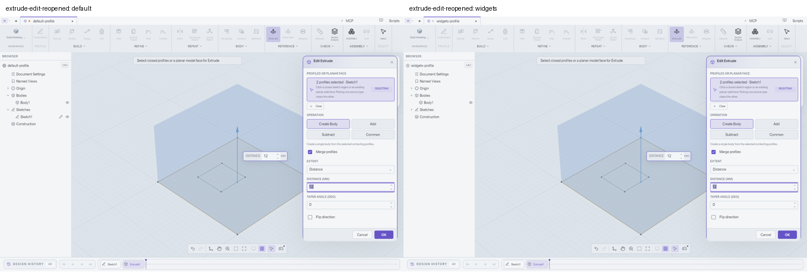
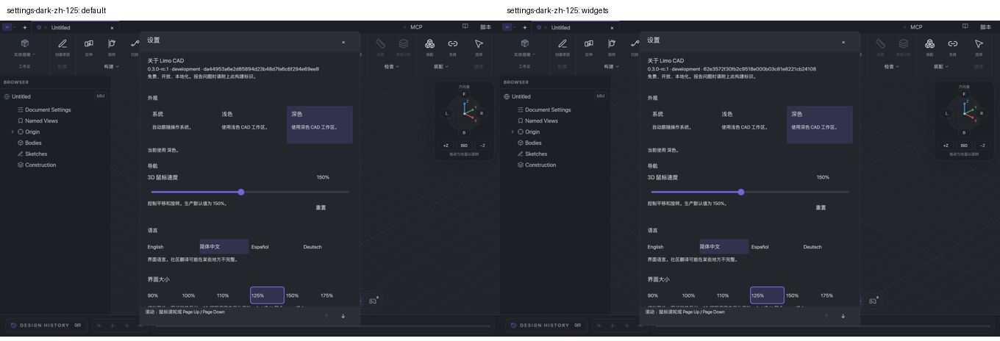
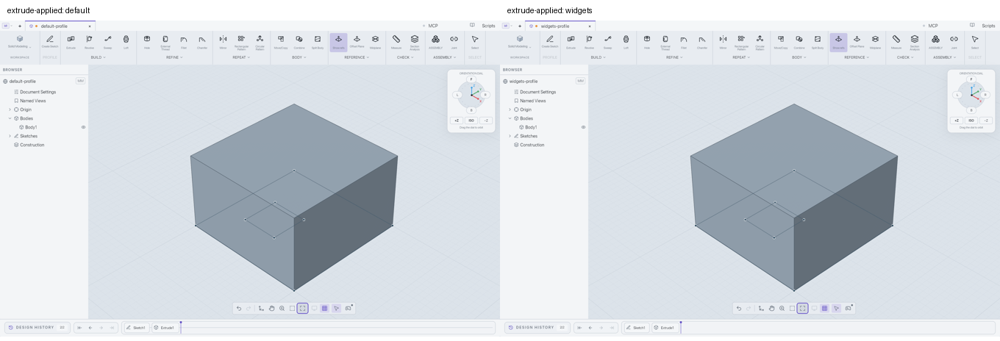
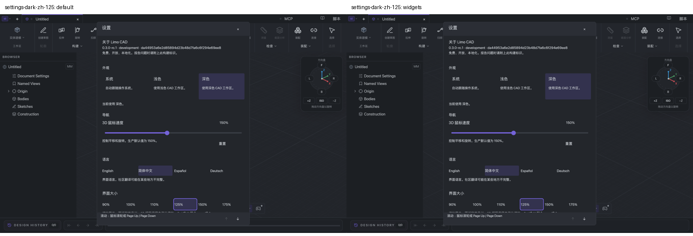
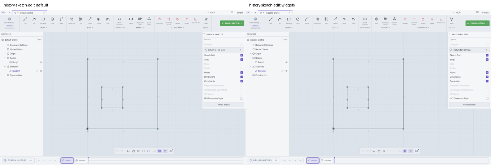

# WIP: Bevy 0.20.0 stable and headless widgets

**Draft only. Human manual verification is required before adoption or merge.**
This exploration originally started from remote `main` at
`736758f291289ff2bb1942a0405027b44e919997`. Current main already includes Bevy
`=0.20.0` stable, so the remaining PR change is the opt-in headless widget
prototype. It is not qualified for release. No human UI passes or broad
qualification-ledger changes are claimed by this PR.

The visual acceptance criterion is a comparable appearance and an intact
workflow. Minor differences are acceptable when they do not obscure state,
change command meaning, clip required content, or prevent an existing action.
Pixel identity is useful evidence, but is not an adoption requirement.

## Why headless widgets

Bevy's headless widgets supply behavior without a visual theme. Keep the current
`ViewportUiTheme`, retained nodes, glyphs, control sizes, spacing, localization
and layout. Feathers has useful editor controls, but adopting its default
appearance would require an additional design/parity pass.

| Control | WIP implementation | Remaining adoption work |
| --- | --- | --- |
| Shared buttons and menu items | `bevy::ui_widgets::Button`, `Pressed`, `Activate` | Manual mouse, keyboard, focus and modal parity |
| Shared boolean checkboxes/toggles | `Checkbox`, `Checked`, `ValueChange<bool>` | Manual command-state and accessibility parity |
| Text, dimension and script fields | Existing Bevy `EditableText` plus native adapters | Preserve ordered editor flush, AltGr/Option, IME ownership and multiline behavior before using `TextInput` directly |
| Sliders/ranges | Existing native range adapter | Bevy sliders use `f32`; CAD ranges use `f64`. Verify precision, step rounding, eight-pixel track inset, drag capture and preview coalescing before migration |
| Choice fields/dropdowns | Existing native choice adapter | Preserve current cycling/keyboard behavior and controlled reducer values before using list/menu widgets |
| Workspace tabs and radio groups | Existing controls and selection reducer | Evaluate `TabList`/`Tab` and radio grouping against current focus order and document ownership |
| Dialogs, popovers and scrolling | Existing native layout/modal policy | Verify stacking, clipping, dismissal, focus return and canvas input ownership before changing behavior |
| Orientation dial and CAD annotations | Existing custom visual/geometry controls | Product-specific controls need their current geometry and hit behavior |

## Input and state ownership

The temporary `experimental-ui-widgets` Cargo feature changes shared button and
checkbox behavior in the real native host. It does not start a second document
controller or create a second UI. Build/run a scratch document for manual review:

```sh
cargo run --locked --manifest-path desktop/Cargo.toml --features experimental-ui-widgets
```

The reworked experiment leaves Bevy's standard picking pipeline enabled. Its UI
backend chooses the control, `Button`/`Checkbox` recognize primary pointer and
keyboard activation, `Hovered`/`Pressed` drive the existing theme, and
`InputFocus` plus Bevy's `TabNavigation` API own focus. A Bevy `GhostNode` holds
the Tab group while leaving the retained UI roots in their original layout. Decorative checkbox squares,
checks and labels are not separate pick targets. The previous `WidgetInput`,
`adapt_input`, `adapt_actions` and synthetic pointer/focused-key events are gone.
The native host bypasses its click recognizer and activation-key path for these
controls; it does not activate the same control a second time.

Tab requests use the native host's existing per-event modifier snapshot with
Bevy's `NavAction::Next` / `Previous`. The automatic Tab plugin reads final
batch key state and failed reverse traversal in the macOS check. This keeps
Bevy's traversal algorithm while preserving Shift on the original event.

The application still chooses eligible controls and Tab order, blocks controls
outside the active modal, and distinguishes primary UI input from CAD secondary
clicks and camera gestures. Published document/binding stamps accompany Bevy's
`Activate`/`ValueChange` notifications into the existing command reducer. A
binding/document change cancels pending pointer state. Native text edits are
flushed before queued widget commands are reduced. These are CAD ownership and
transaction responsibilities, not a second widget event implementation.

Checkbox state remains controlled by accepted application commands. Some
checkboxes perform commands such as Fix/Unfix, so a value proposal preserves the
command intent and `Checked` is projected from the accepted state. Text editing,
precision ranges, choices, menus' arrow navigation and other unmigrated controls
retain their existing adapters. The flag keeps the old default available as the
visual/workflow baseline during this draft experiment.

Migrated controls retain their real Bevy accessibility nodes. The native
projection supplies their localized labels, bounds and command bindings on
those same entities, instead of creating duplicate proxy controls or deleting
Bevy's nodes. Unmigrated controls still use their existing accessibility
projection. Screen-reader behavior remains a separate acceptance item.

The 2026-10-16 results below describe the earlier guarded adapter. They are
historical evidence, not passes for this standard-input rework. The separate
rework checks below use clean builds with PR433 and PR434 locally integrated;
the broad qualification ledger remains paused.

## Standard-input rework, 2026-10-17

PR420 source `8b0051f4` replaces the guarded adapter with standard Bevy picking,
button/checkbox activation, hover/press state, and focus navigation. The local
validation branch combines main `49dec66d`, PR433 `5cde5c0d`, and PR434 `fcbde1b7`.
The dependencies are not included in PR420's published branch.

Fresh native macOS checks on clean integration `62e3572f` verified File/Settings,
light and dark themes, Chinese labels at 125%, scrolling, pointer/Space settings
toggles, two-profile Merge extrusion, 12 mm field editing and single Apply,
earlier-sketch editing, Undo/Redo, save/reopen, and canceling an edited feature.
The saved schema-15 model is exactly equal to the default baseline's model.
The Snap square now toggles successfully; the existing focus retirement after
changing Snap remains, so a subsequent Space does not toggle it until focus is
reacquired. This is an unresolved baseline limitation, not a visual difference.

Thirteen capture pairs are retained with raw differences and revision identities.
The controls retain comparable labels, layout and sizing. Some pairs have
intentionally different selected settings, preview distances, camera positions,
focus, or browser expansion; those pairs are layout comparisons, not pixel
identity claims. The reopened Extrude dialog differs by 62 pixels within its
640-by-1252-pixel region. Checkbox glyph/focus differences do not block the tested
workflows.

Three regressions were found and repaired: a non-UI focus parent excluded roots
from layout (use Bevy's `GhostNode`); widget input partitioning could consume an
existing native drag release (preserve its current owner); and Shift+Tab moved
forward on macOS (pass the native event's modifiers to Bevy's `TabNavigation`).
Final integration `5ebe37bc` passed strict library/test Clippy, 98 interface tests,
13 native-host tests, and the release package build. Live native input then
verified reverse Tab in Settings, focus across native fields and Bevy controls,
Space activation, release outside Finish Sketch followed by a normal click,
and canvas/slider drags released over buttons. The slider stayed active through
release without closing Settings; subsequent Reset and Close clicks worked.
After editing/canceling and finishing the sketch, the saved model still matches
the default baseline byte for byte. The scoped result is **12 passed behavior
cases and one shared Snap focus issue**, with no pending affected rechecks.





MCP was used only for matched-build inspection and image capture. All modeling
input used the user-authorized native app automation. No scripts, replay,
raw inbox writes, or MCP mutations were used. The broad qualification ledger
remains paused; this is a focused comparison, not complete UI or screen-reader
qualification. The feature remains opt-in and the PR remains draft.

See [rework evidence](qualification/bevy-widgets-standard-input-20261017.json).

## Stable dependency and window-host patch

The desktop pins `bevy`, `bevy_ecs`, `bevy_gizmos` and `bevy_reflect` to
`=0.20.0`; the desktop lockfile resolves the Bevy family to stable versions.
Stable also advances Bevy's WESL dependencies to 0.6.0, requiring native render
verification in addition to compilation.

The published stable `bevy_winit` source files are identical to rc.2. Refresh
the normalized stable manifest and archive provenance, preserving the only
local source patch: explicit service wakes advance schedules without an OS
redraw. Its regression must pass on the upgraded dependency graph. See
[the patch record](../desktop/vendor/bevy_winit/LIMO-PATCH.md).

## Source checks

```sh
cargo check --locked --manifest-path desktop/Cargo.toml --all-targets
cargo check --locked --manifest-path desktop/Cargo.toml --all-targets --features experimental-ui-widgets
cargo test --locked --manifest-path desktop/Cargo.toml --lib --features experimental-ui-widgets native_viewport::interface_shell -- --test-threads=1
cargo test --locked --manifest-path desktop/Cargo.toml -p bevy_winit explicit_service_wakes_advance_app_without_os_redraw_and_return_to_idle -- --test-threads=1
cargo test --locked --manifest-path desktop/Cargo.toml --test bevy_020_widgets
```

The existing native-host CI additionally runs the focused widget regressions
with the experiment enabled on Linux, macOS and Windows. Source/headless checks
do not establish visual or physical UI parity.

Local macOS source validation on 2026-10-14 passed both all-target compile
checks, the CI all-target/all-feature Clippy check, 96 distinct native-interface
regressions across scoped runs, the explicit-wake regression and all three
stable text-widget characterization probes. The windowless native GPU
UI/compositing regression also passed. These results leave the human checklist
below outstanding; they do not qualify supported platform packages or full
custom-shader coverage.

## Focused integration check, 2026-10-16

The resumed comparison uses clean integration revision `da44953a`, combining
main `49dec66d`, the updated PR433 head `5cde5c0d`, PR434 `fcbde1b7`, and PR420
code checkpoint `21e0ef5d`. The dependencies remain locally merged only; they
are not included in PR420's published diff. The earlier initial-window run at
`1e393585` used PR433 `467fe8b9` and is preserved as historical evidence.

Jack authorized native macOS app automation for this focused comparison.
Two separately signed, self-contained Apple silicon apps were built from the
same clean integration revision, with the widget feature disabled and enabled.
Both load bundled OCCT 8.0.1. Native pointer and keyboard input exercised isolated
scratch documents; MCP only inspected and captured their state. The matched
client size was 1360 × 860 logical pixels, at 200% display scale.

The scoped run records **11 passed behavior cases, one shared baseline issue,
and 13 paired visual states**. No new widget regression was observed in these
cases. This is not full UI qualification or human adoption acceptance.

| Exercised behavior | Observed result |
| --- | --- |
| File menu and Settings | Matching labels, icons, disabled entries and single activation |
| Light/English/100%; dark/Chinese/125% | Comparable sizing, selection, focus and translated labels; lower settings remain reachable by scrolling |
| Settings boolean toggle | Pointer switches it off; Space switches it on, verified in the accepted control state |
| Two sketch regions and Merge profiles | Center and ring select independently; merging previews one combined volume |
| Distance edit and Apply | 12 mm is committed before one extrusion is added; one body and two total history features |
| Earlier sketch edit | Later extrusion disappears from the canvas while Sketch1 is edited, then returns on Finish |
| Release outside Finish Sketch | Widget build stays in sketch mode; the canceled gesture does not finish it |
| Undo/Redo and save/reopen | Body and history restore; both saved schema-15 model payloads are exactly equal |
| Feature edit and Cancel | Two profiles, Merge and 12 mm persist; canceling a flipped preview restores the original body |
| Snap palette row/square | Shared issue described below; not counted as a functional pass |

The primary modeling captures match after accounting for different fixture
names and a two-pixel-high history-track line. Settings and File menu captures have
different empty-grid positions; their controls have matching bounds and state.
The reopened feature dialogs are pixel-identical. Additional differences are
confined to the header, browser expansion and history track after the differing
inspection sequences.
Raw pixel differences and capture hashes are retained, rather than described
as a universal pixel-identity pass.







**Shared baseline observation:** in both apps, clicking the displayed Snap
square did nothing, while clicking its row toggled it. After the row toggled,
inspection reported no focused control and Space did not toggle it. Snap was
restored in both fixtures. This remains unresolved and needs human reproduction
and inspection of native hit targets/focus retirement; no widget-specific cause
was established. It is recorded as an issue, not a pass or an accepted cosmetic
difference.

The updated PR433 integration passed two profile-selection migration tests and
five native OCCT region tests. The earlier integration passed all 97 native
interface tests, including seven widget cases, and the native GPU compositing
regression. Their revisions are recorded separately. Those source checks are
not substitutes for the native interaction evidence.

Live Revolve, the complete control catalog, held-key/re-entry/deactivation edge
cases, full focus traversal, IME, screen readers, other display densities and
Windows/Linux visual checks remain untested in this scope. Native file-chooser
automation needed deliberate key presses on one retry; the verified path opened
successfully afterward. Neither that automation behavior nor earlier window
enumeration failures are attributed to a locked Mac or a product defect.

The [focused evidence record](qualification/bevy-widgets-20261016.json) includes
expected/actual results, build hashes, fixture paths, captures, unresolved
observations and explicit exclusions. The broad UI/MCP ledger remains paused
and unchanged. The feature stays opt-in and this PR stays draft.

## Required human manual verification

Compare the same scratch fixture on stable/default and stable/experiment at
matched window size and display/interface scale. Record
build identity, expected versus actual behavior and screenshots where useful.
Do not reuse previous qualification passes as evidence for changed controls.

- [ ] Light/dark themes, localization, 100%/200% display and interface scaling:
      labels, glyphs, dimensions, spacing, hover, selected/pressed/disabled
      colors, focus rings, clipping and tooltip placement remain comparable. Minor
      differences are acceptable if the workflow remains intact.
- [ ] Toolbar, ribbon, dialog and menu buttons activate exactly once on release;
      dragging outside, releasing outside, window deactivation and cancellation
      do not activate. Re-entry while captured matches the baseline.
- [ ] Checkboxes and command toggles reflect accepted state, including rejected
      operations. Rapid repeated clicks and double-click behavior match.
- [ ] Tab/Shift-Tab, Enter/Space, held-key repeat, modified activation keys,
      context menus and menu navigation match. Bevy buttons suppress repeated
      key activation; verify whether that differs from the baseline and resolve
      any difference before adoption.
- [ ] Opening/replacing a modal, switching/reopening a document, reusing a row,
      hiding/disabling a pressed control and model work in progress cannot
      activate a replacement target or leak input into the canvas.
- [ ] Text edits commit in the original event order before button activation;
      dimensions, script editing, clipboard, AltGr/Option and Japanese/Chinese
      IME remain correct through focus and document changes.
- [ ] Existing sliders, range precision/rounding, previews, dropdowns, tabs,
      scrolling, Undo/Redo and save/reopen behave as before.
- [ ] Screen-reader names, roles, checked/disabled state, tab order and activation
      are correct with no duplicate controls or stale focus.
- [ ] CAD rendering, custom WESL shaders, native GPU stock, resizing, occlusion,
      idle service wakes and owned-frame presentation work on supported platforms.

Keep the PR draft/WIP until a human records these results and explicitly accepts
the scoped parity. Broad UI/MCP qualification remains governed by the existing
paused ledger and is not resumed by this exploration.
