# Modeling kernel choice: the Settings flow in the native window

The Limo kernel is chosen under File > Settings > Modeling kernel and takes
effect the next time Limo CAD starts. These are captures of that flow in the
real window, one for each checkpoint.

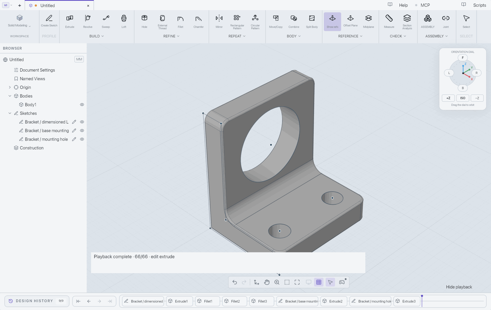

1. First start with nothing saved. The built-in lesson "Bracket foundations:
   sketch, extrude, fillet and cut" plays to the end.
2. The File menu, with Settings in it.
3. Settings opens. About Limo CAD shows the build.
4. Modeling kernel: Open CASCADE is selected and running.
5. Limo (experimental) is chosen. The choice is saved, and Open CASCADE keeps
   running until the restart.
6. After the restart the same lesson plays again.
7. Settings shows Limo selected and running.

The section in its three states, in capture pixels:

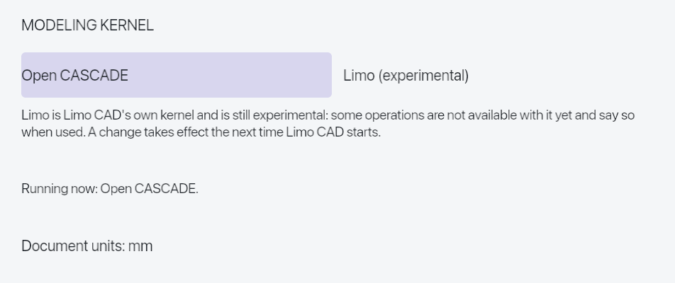

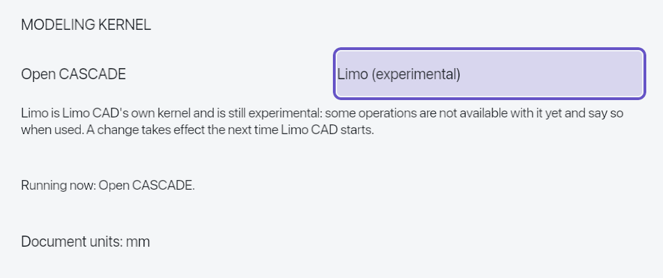

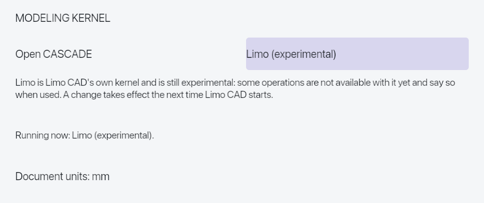

## Every shipped language

The same section in English, 简体中文, Español and Deutsch, each from a start
of its own in that language, at the interface sizes of 100% and 175%. These
starts had `LIMO_CAD_KERNEL=limo` set, so the status line is the longest one
the section shows: the kernel that runs, and that the environment put it
there.

| | 100% | 175% |
|---|---|---|
| English | 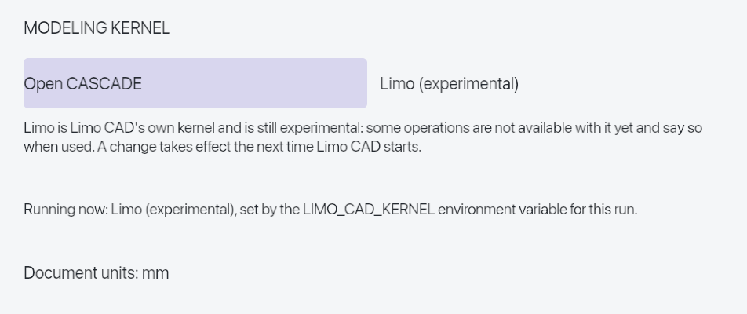 | 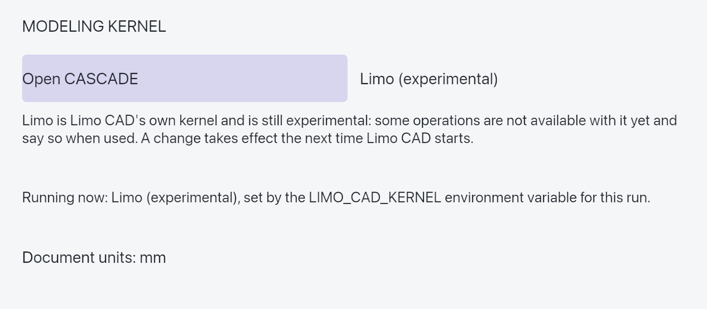 |
| 简体中文 | 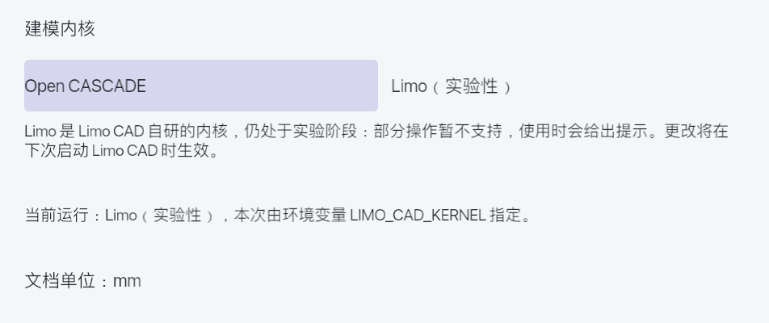 | 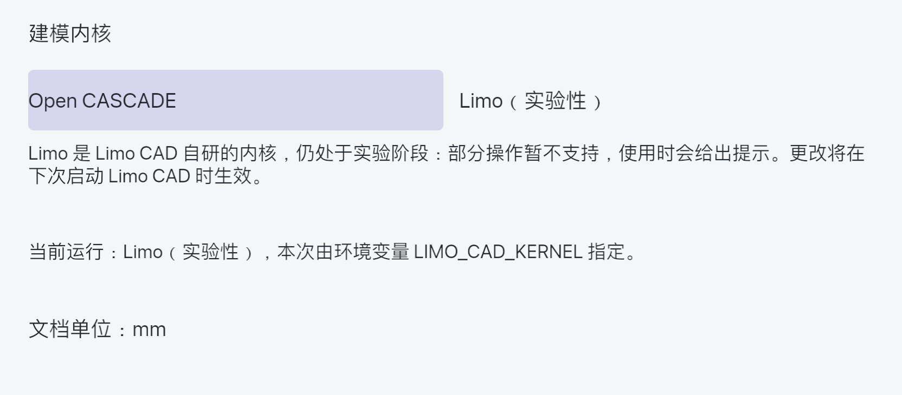 |
| Español | 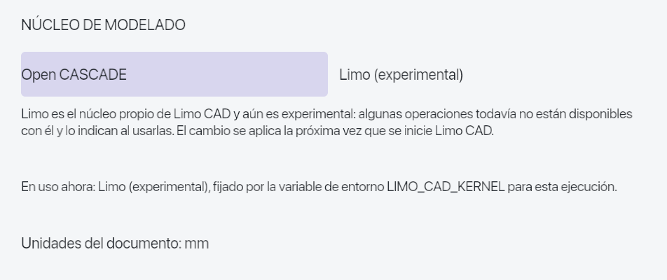 | 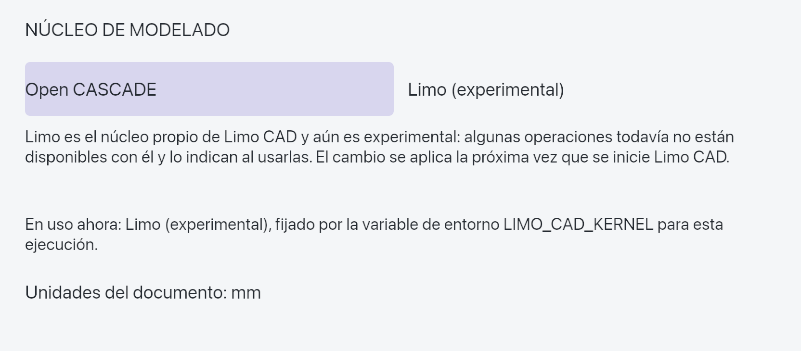 |
| Deutsch | 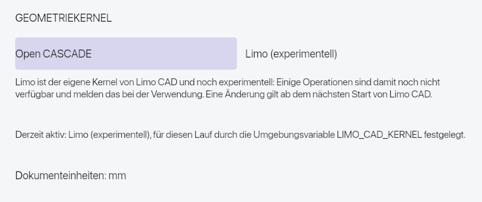 | 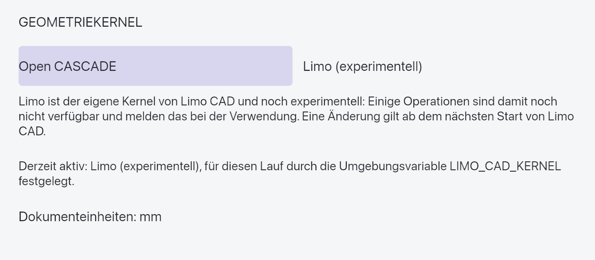 |

In all eight the heading, both choices, the description, the status line and
the line after the section are whole: no glyph is missing, nothing is cut
off, and wrapped lines stay inside the panel. At either size the "More
settings" control brings the list to its end, where the whole section is in
view.

## What the run checked

- The window's own process logged every rebuild with the kernel that did it
  (`LIMO_CAD_KERNEL_TIMING`, set for the window alone): ten rebuilds on Open
  CASCADE before the restart and ten on Limo after it, none with a feature
  error.
- On both starts the lesson ran its 66 steps and 6 checks and left one body
  of 32 x 40 x 44 mm with 38 faces and three holes.
- Choosing Limo wrote `"kernel": "limo"` to the preferences file at once, and
  Settings reported it as the effective choice before and after the restart.
- In each language start the window reported that language as the one in
  effect, Open CASCADE as the saved choice, and the interface size asked for.

## Source and method

The application is a release build of revision
`bd8a2efa63169fc3f32ca63cb9addce165fcb4ec`, unmodified, with the Limo kernel
at `068cb4415547ae24fe94f3bfe2d9e5160672a64a` and Open CASCADE 8.0.1, on macOS
26.6.2 (arm64) in the light appearance at a display scale of 2. It ran with
configuration and session folders of its own.

A helper process attached to the window activated its controls through the
application's interface tool (`cad_interface`: script, view, inspect, click,
capture) and asked the window for each capture. The GIF holds the seven
captures in order at half size. The stills are crops of whole-window captures
at full size. [provenance.json](provenance.json) has the identities and
hashes.

## Limits

- Controls were activated through the application's own control interface,
  not with the pointer or the keyboard, and a capture can itself ask for a
  redraw. This is a sequence of checkpoints, not a continuous recording.
- One lesson on one platform. The Windows and Linux windows were not
  recorded.
- The window kept the size it opens at, 1360 x 860. The smallest size it
  allows, 1200 x 760, was not recorded: the control interface cannot size
  the window.
- The lesson's feature summary is the same on both kernels except for the
  extent of its three holes: unknown on Open CASCADE, through and 8 mm deep
  on Limo. The Open CASCADE bridge states which faces lie on a body's outer
  shell only when every face is a plane or a cylinder, and this bracket has
  rounded corners. The Limo adapter states it for every single solid. A part
  without rounded corners, the "Four-hole mounting plate" lesson, gives the
  same summary on both.
