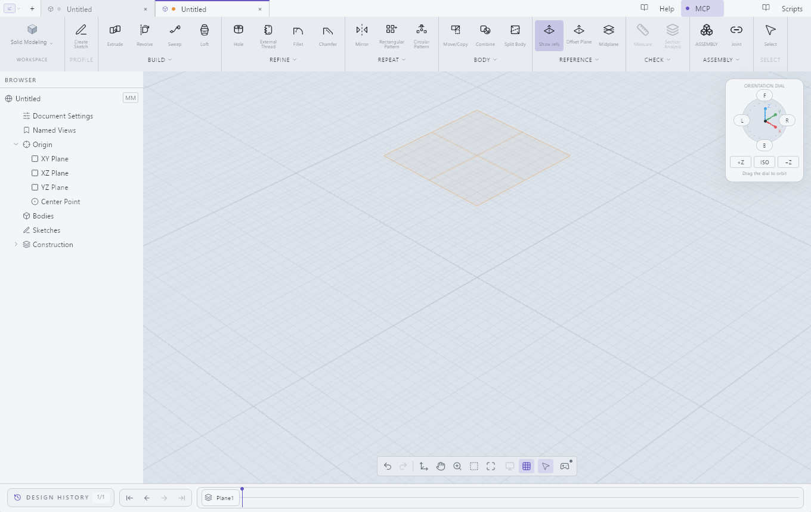
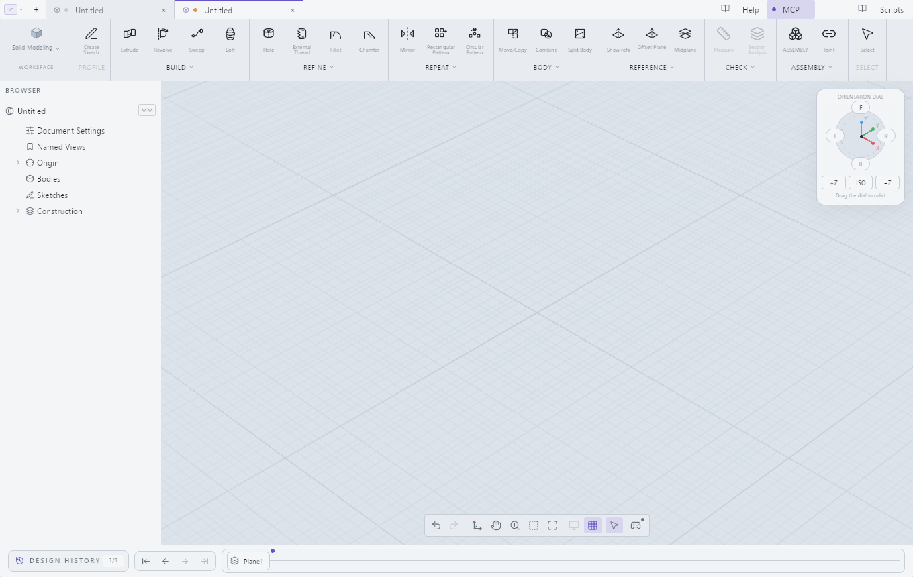
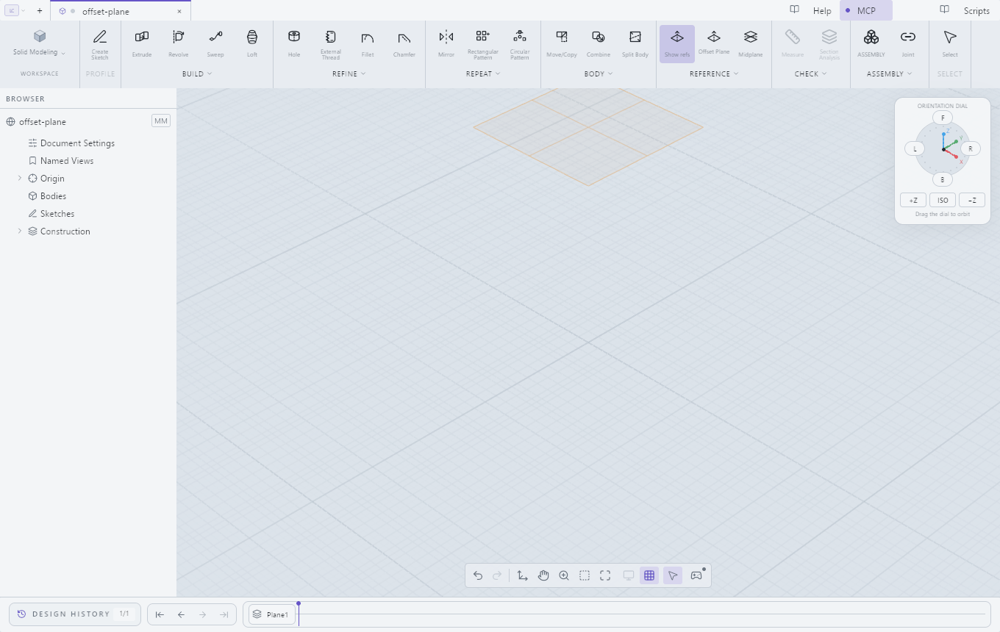

# Offset plane: focused native reproduction of #383

This constructed sequence did **not** reproduce a missing plane. In a fresh
owned design, create an XY offset plane at 25 mm and capture immediately after
Apply, with no unrelated modeling command, view change or inserted wait.



Editing to 35 mm retained plane identity. Undo restored 25 mm and Redo restored
35 mm. Hiding the plane removed it from the capture; showing it restored it.



Save, close and reopen retained the edited definition and its rendered plane.



## Run the finite proof

```text
cargo xtask test-offset-plane --server PATH_TO_CAD --expected-revision FULL_COMPILED_SHA --out FRESH_ABSOLUTE_DIRECTORY
```

The command launches one owned child with private configuration and session
storage, verifies its compiled revision and unmodified flag, and selects only
that child's published document. It does not redeploy the managed CAD, send OS
input, or attach to an existing user document. It retains nine PNGs, bounded
child logs, a saved project and a result report. Startup failures can occur
before the report is created; inspect the retained child logs in that case.

The application is the successful Windows x64 CI package for release candidate
`de965ef5`, compiled at merge commit `fa2f3240`. Their Git trees are identical.
The relevant application sources equal the investigation branch apart from its
two added unit tests; the product version differs (0.3.0 versus rc.3).
See [evidence.json](evidence.json) for full identities, OS facts and image hashes.

**Limits:** captures use the native control API and can themselves request a
redraw. This does not rule out a passive-wake or OS-input-only defect. It does
not establish Kubuntu behavior or reproduce the original reporter's unspecified
build and sequence. The issue remains open; this is regression coverage and a
reproduction aid, not a claimed product fix. The broad UI/MCP survey stays paused.
