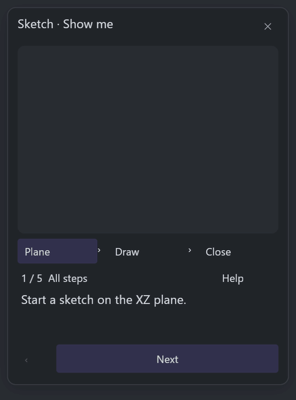
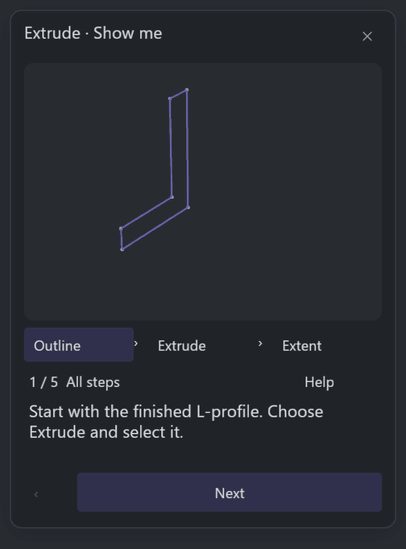
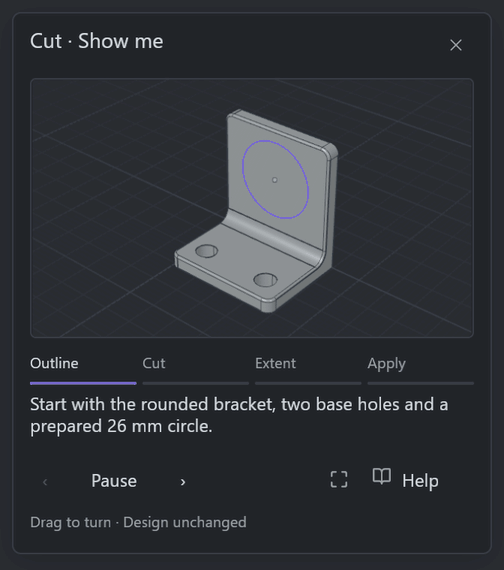
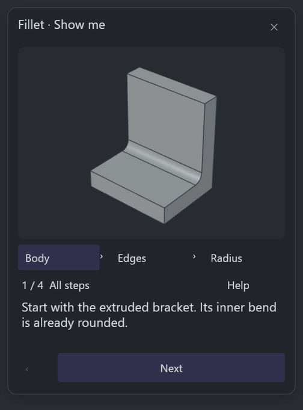
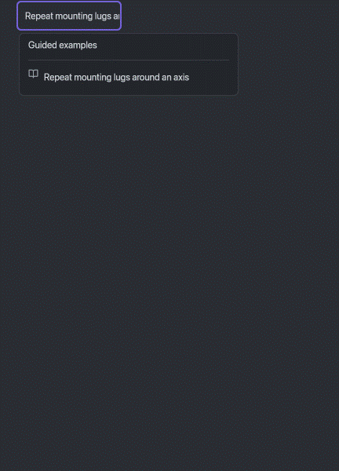
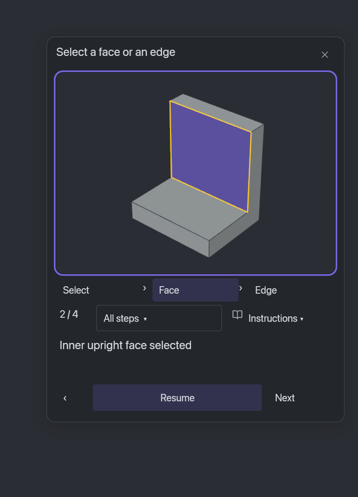

# Show me: Sketch and Solid

58 guides teach one operation at a time, with 236 authored frames on the shared
bracket workflow. Playback starts automatically. Pause, Instructions, Resume,
clickable steps, Replay and Close operate on the retained native preview.
English, Simplified Chinese, Spanish and German use the same lesson catalog.

## Native walkthroughs

These five GIFs contain twelve recorded checkpoints each, including automatic
playback, Pause, inline Instructions, Resume, completion and Close. They show
the actual native widgets and controller in a windowless component fixture.
The entry button is a fixture anchor; production ribbon keyboard access is
covered by the separate companion regression below.

**Sketch: close and dimension the bracket section.**



**Extrude: give the section its 40 mm width.**



**Cut: make the upright opening with Through all.**



**Fillet: round the bracket's outside corners.**



**Circular Pattern: repeat mounting lugs about an axis.**



## Detail captures

The full-resolution PNGs preserve native pixels. These captures show the shorter
navigation labels, the independent Point marker, and the authored dimensions.



- [Standalone Point](sketch-point.png)
- [Arc radius and angle](sketch-arc.png)
- [Driving length dimension](sketch-dimension.png)

At the supported 1200 × 760 window and 175% UI scale:

- Compact navigation: [English](selection-175-en.png),
  [Chinese](selection-175-zh-CN.png), [Spanish](selection-175-es.png),
  [German](selection-175-de.png).
- Complete Extrude instructions and footer: [English](help-175-en.png),
  [Chinese](help-175-zh-CN.png), [Spanish](help-175-es.png),
  [German](help-175-de.png).

## Validation and provenance

[Native run 41083664402](https://github.com/limo-cad/Limo-CAD/actions/runs/41083664402)
passed on application source `bdb55e0f9201c15c4ca4184c7612c349ebea2c33`.
That head had 36 successful checks and 11 intentional skips. The native suite
covered all 58 guides, both Cut outcomes, four locales at 175%, instruction bounds,
dimension raster ink, lifecycle cleanup and single/multi-edge transitions.

The real production-ribbon companion regression passed:
`native_script_preview_tabs_after_extrude_in_the_production_ribbon`.
It covers Extrude → Show me with the production Cut/Revolve neighbors and reverse
navigation from Fillet. It establishes a keyboard route through those native
controls; physical OS input and the broad live UI survey remain unqualified.

The compiled commit was `f863c4f4d76ced6a9f9894298e2e9aa2443bb30e`, whose Git tree
equals the application source tree. The debug build reports `compiled_modified:
true` after its own-engine asset generation. All 58 generated asset hashes and
all 27 recipe hashes match the frozen application source: 236 frames and
3,956,447 asset bytes.

[evidence.json](evidence.json) records media hashes, original frame order, actual
recorded delays, source identities and artifact references. GIFs are encoded at
432 × 600 from 864 × 1200 checkpoints, with lossy palette conversion and delays
rounded to the nearest centisecond. They are checkpoint walkthroughs; continuous
motion, FPS and physical pointer delivery are outside this capture scope.

[measurements.json](measurements.json) retains the 59 native component cases,
including the second Cut outcome. In the macOS/aarch64 debug fixture, cold opening
took 542–1,894 ms and reopening took 53–351 ms. A three-pass warm replay averaged
195–551 ms per pass and submitted 12–15 geometry render jobs. Cached adjacent
navigation submitted zero additional GPU jobs. All cases recorded zero idle
preview wakes over 100,000 polls and zero cached image bytes after Close.
These measurements describe the windowless controller and its owned caches;
whole-application CPU/GPU utilization and driver memory remain unqualified.

The source archive is artifact `12995075556`. Acquisition used bounded ranges
for selected original entries; entry names, flags, methods, CRCs, lengths and
retained SHA-256 values were checked. Its API-reported archive digest is recorded
in the manifest; the whole archive digest was not recomputed.

The previous four-guide bundle and its original review receipts remain available
at this [immutable historical snapshot](https://github.com/limo-cad/Limo-CAD/tree/bdb55e0f9201c15c4ca4184c7612c349ebea2c33/docs/media/show-me-foundations).
Current published media stays within the 8 MiB budget. The application code,
native tests, recipes and CBOR payloads are unchanged by this evidence refresh.

To reproduce with the matching OCCT SDK and registered Cargo lane, choose fresh
evidence directories and run:

```powershell
$env:LIMO_CAD_SHOW_ME_PROOF_DIR = '<fresh directory>'
cargo xtask ci native-ignored-test show-me-ui
$env:LIMO_VIEWPORT_RENDER_PROOFS = '<fresh directory>'
cargo xtask ci native-ignored-test show-me-lifecycle
```

The reference part has a 32 mm base length, 40 mm width, 44 mm height and 8 mm
walls. These dimensions were inferred from the README branding concept. The
fixtures use their own bracket and leave user documents untouched.
