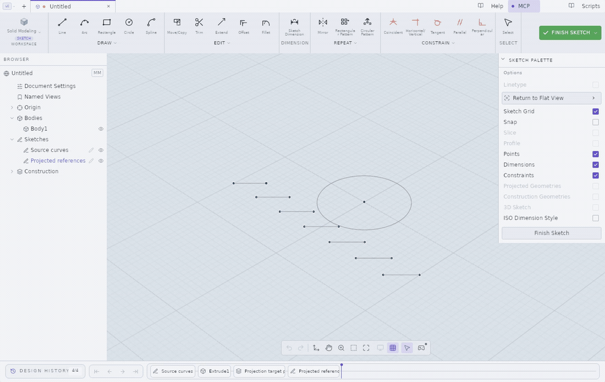
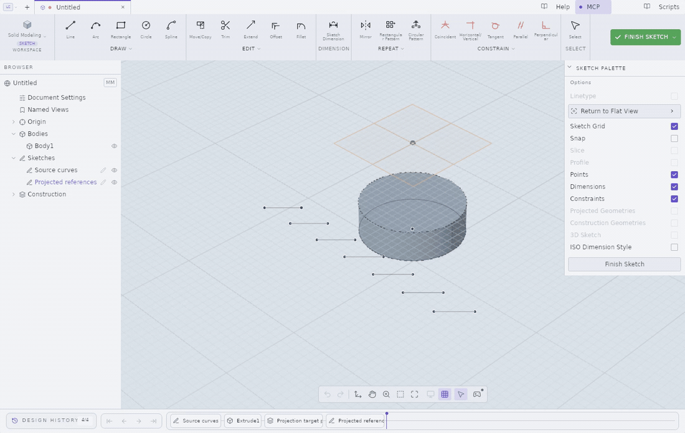

# Associative Sketch Projection — native evidence





These are continuous captures of the real native Linux application on one owned
private Xvfb display. The fixture uses actual XTEST Tab, Shift+Tab, Enter and
Escape events through the production ribbon/menu/picker hierarchy. Model setup,
Undo/Redo and reference removal use the native control API and shared MCP.
Reading pauses are fixture delays, not performance measurements.

The fixture creates eight source curves, a small cylinder and an offset target
sketch. The blue circle is a preview; the purple circle is a confirmed reference.
Assertions verify preview/Cancel preserve the sketch, confirmation adds exactly
one reference, and Undo/Redo and removal change the expected association count.
Each recording retains its independent40-second/8MiB limit. The completed clips
contain130 and217frames at6fps, respectively.

- [Full-resolution preview](01-preview.png)
- Actual1200×760 client at175%: [English](locale-en-minimum.png),
  [Spanish](locale-es-minimum.png), [German](locale-de-minimum.png),
  [Chinese](locale-zh-CN-minimum.png)

[Run42745011023](https://github.com/limo-cad/Limo-CAD/actions/runs/42745011023)
passed on clean matched desktop/MCP source
`9ea82339d04aa89495b3256b9b93b7437c6bbc74`, development0.3.0-rc.3.
The native test binary is a hosted debug build; this is functional evidence.
The locale captures qualify the new picker text, glyphs, paging and fixed actions.
The high-scale panel obscures much of the model and does not qualify whole-app
layout. Original next-page captures, videos, logs and receipts remain in
[artifact13731610751](https://github.com/limo-cad/Limo-CAD/actions/runs/42745011023/artifacts/13731610751).
The archive digest in the manifest is GitHub's reported value; the whole archive
was not independently rehashed. Published file hashes are computed from the
retained original entries. GIF names were shortened for publication; the manifest
maps each name to its original recording metadata.

[Manifest](manifest.json) and [Linux functional result](linux-functional-result.json)
record the exact scope. OS pointer delivery, physical hardware input,
Windows/macOS OS input and performance remain unqualified. Broad UI coverage is
still paused. No installed CAD, user document or global preference was changed.
The separate macOS packaged shutdown failure remains tracked in#374.

Earlier clean Windows035db7a8 evidence, including stale Confirm rejection and
remove/Undo, remains available in [the preceding evidence snapshot](https://github.com/limo-cad/Limo-CAD/tree/9ea82339d04aa89495b3256b9b93b7437c6bbc74/docs/media/sketch-projection).
The retained [Windows functional result](functional-result.json) belongs to that
recorded build; it is not a Linux receipt.

Reproduce the finite acceptance with an exact-source binary on a private Linux display:

```sh
GITHUB_SHA=$(git rev-parse HEAD) dbus-run-session -- \
  xvfb-run -a -s '-screen 0 1360x860x24' \
  cargo xtask test-mcp native-projection \
  --server /absolute/path/to/clean-matched/limo-cad \
  --out /absolute/fresh/evidence-root
```

The native-host workflow's opt-in `projection-proof` input builds that source
and retains partial evidence on failure. A successful receipt requires subsequent
inspection of the actual native media before review readiness.