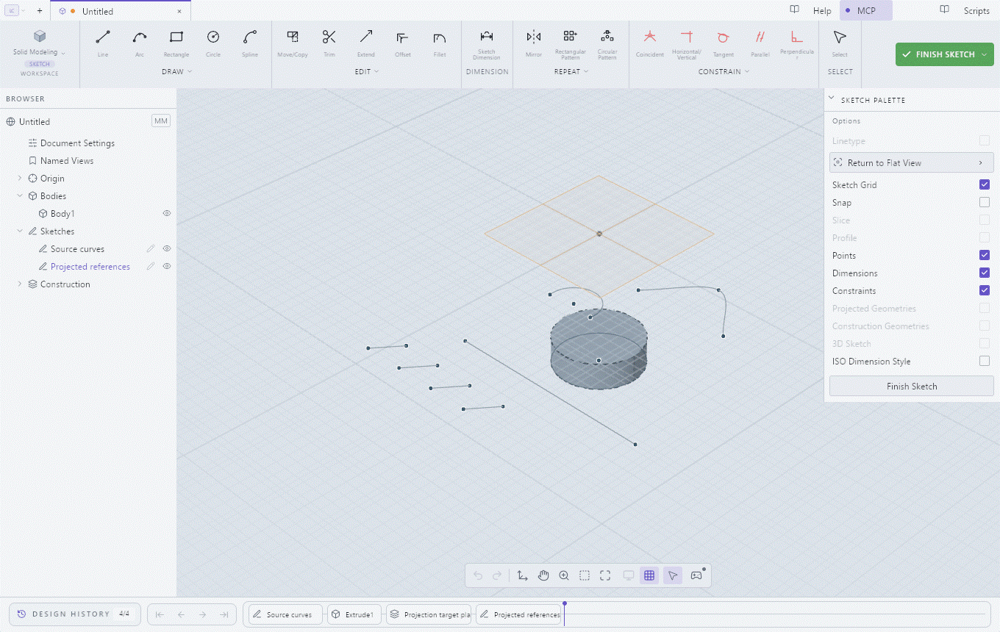

# Associative Sketch Projection — native evidence



This is a ten-checkpoint walkthrough from the real Windows native application,
with equal 2.5-second reading holds. It is **not continuous video, measured action
timing, or OS pointer/keyboard evidence**. Full-resolution PNGs retain readable
text without GIF palette dithering.

The fixture creates eight source curves, a small extruded body and an offset
target sketch. The blue line is the uncommitted candidate; the purple line is
the confirmed associative reference. Cancel returns to the original sketch.
The accompanying state assertions verify unchanged sketch data on preview and
Cancel, rejection of a retired Confirm target after changing the candidate,
exactly one confirmed reference, Undo/Redo, and removal followed by Undo.

- [Preview and Confirm controls](02-preview.png)
- [Confirmed reference](05-confirmed.png)
- [References and removal](08-references.png)
- 175% layout: [English](locale-en-preview.png), [Spanish](locale-es-preview.png),
  [German](locale-de-preview.png), [Chinese](locale-zh-preview.png)

All captures use the clean `035db7a8808755d2f09e6a2afb93c7f0a0d6d4d4`
desktop and embedded MCP pair, development channel `0.3.0-rc.3`, in one fresh
owned document. The Windows client is 1360×860. The localized captures qualify
the new picker text and controls; the high-scale panel obscures part of the model
and does not qualify whole-application layout. [Manifest](manifest.json) records
all published bytes, source-frame hashes, OS build and encoding scope.

The native control API delivered the fixture actions, including Enter/Escape on
production controls. Two computer-use connectors refused to bind the private
test window with an ownership error; no OS input was sent through them. Actual
minimum-window rendering, OS keyboard traversal, and continuous recording remain
pending the disposable Linux `native-projection` fixture. Unit bounds at
1200×760/175% do not substitute for those captures. The broad UI survey remains
paused. No deployed CAD, user document or global preference was changed.

To reproduce the remaining finite acceptance on an owned Linux Xvfb display:

```sh
GITHUB_SHA=$(git rev-parse HEAD) dbus-run-session -- \
  xvfb-run -a -s '-screen 0 1360x860x24' \
  cargo xtask test-mcp native-projection \
  --server /absolute/path/to/clean-matched/limo-cad \
  --out /absolute/fresh/evidence-root
```

The opt-in `projection-proof` input on the native-host workflow builds that
source and retains partial evidence on failure. Its result is not claimed here.
