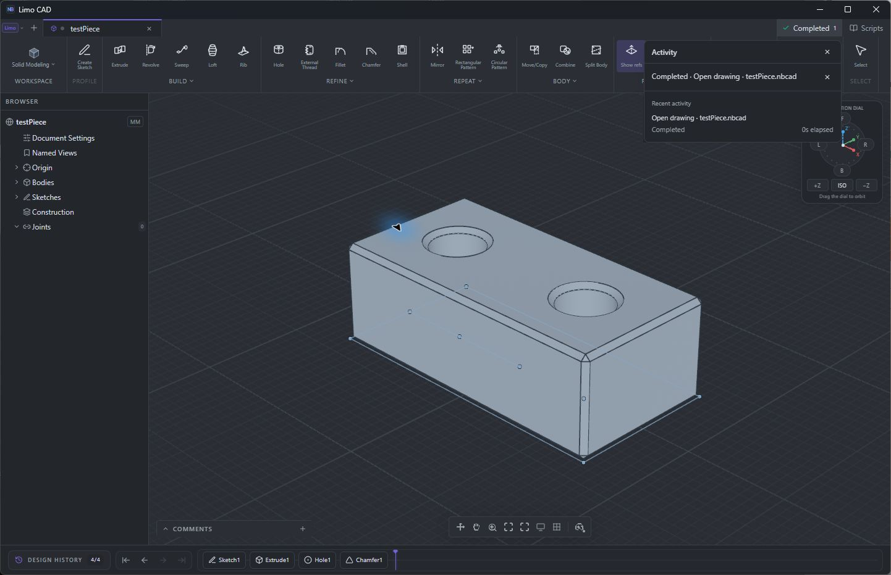

# Loading feedback in the UI

Limo CAD uses a small startup splash while the application initializes and a compact top-bar **Activity** indicator for work in the ready workspace. Activity covers opening files, importing, exporting, saving, rebuilding geometry, preparing drawings, and CAM operations.

## Activity

The indicator appears when work begins. Its panel shows the operation and target file, actual phase, elapsed time, recent results, and expandable error details that can be copied. Detailed progress waits 300 ms to avoid flicker for short operations. Completion and failure notifications remain available until dismissed; history and notification counts are bounded.

Progress follows real operation boundaries. File Open reports reading, validation, geometry preparation, document adoption, and rendering. Native 3D Open completes after the current model revision is presented at the viewport's actual size. Geometry computation, drawing projection, and CAM use their existing task ownership; computation completion does not claim that a 3D frame has been presented. Abandoned pickers and superseded jobs retire silently.

The panel leaves the CAD canvas visible and respects existing operation guards. Keyboard focus belongs to the open panel, Escape dismisses it, and focus returns to the Activity button. English, Simplified Chinese, Spanish, and German follow the application's language preference and fallback rules.

## Window and document behavior

Ordinary launches bring the existing window forward. File requests wait for application readiness and ongoing operation guards, then use the normal **Save / Don't Save / Cancel** decision. A document ownership check before replacement protects edits or tab changes made while the request is pending. Cancelling preserves the active document and its unsaved work. **File → New Window** and `--new-window` create an independent workspace.

Successful startup remains complete for that window. Activity operations and runtime errors do not display the startup splash. Recipe links open editable source without executing it.

The safe-Rust launch broker holds an OS file lock and uses authenticated, bounded loopback delivery with retained requests and acknowledgements after handling. Executable identity and private profile/report namespaces isolate development and diagnostic launches from installed user windows. Private profiles and startup reports bypass ordinary reuse unless `--reuse-window` is supplied. Failed delivery falls back to an independent launch rather than losing the request.

## Verification

Frontend tests cover startup completion, task ownership, silent abandonment, durable failures, nested/concurrent geometry work, frame readiness, and four-locale copy. Browser checks of the production Open path hold file IPC while an edit or tab replacement occurs; both reject stale consent before native replacement. Native library verification records **130 passed, 0 failed, 6 intentionally ignored**.

Thunder Windows checks cover empty startup, a file forwarded during startup, the rendered sample and its four history entries, ordinary reuse, explicit New Window, unsaved-change cancellation, viewport interaction, Activity Escape/focus, and missing-file errors preserving the loaded document. Four localized Activity layouts fit a 1280 × 800 viewport without horizontal overflow.

[Native verification artifact](startup-measurements/runtime-native-staging-keyboard-final.json) · [Document replacement verification artifact](startup-measurements/runtime-native-staging-final.json) · [Frontend test results](startup-measurements/runtime-frontend-tests.log) · [Native test results](startup-measurements/runtime-native-tests.log) · [Locale layout results](startup-measurements/captures/runtime/layout-checks.json)

## Visuals

Native Activity over the rendered sample:



Runtime error details with the sample still available:


The localized component captures use simulated named operations to check layout and copy:

- [English](startup-measurements/captures/runtime/en-activity.png)
- [Simplified Chinese](startup-measurements/captures/runtime/zh-CN-activity.png)
- [Spanish](startup-measurements/captures/runtime/es-activity.png)
- [German](startup-measurements/captures/runtime/de-activity.png)

## Reproduction

```powershell
npm run test:frontend
npx tsc --noEmit
npm run build:desktop
```

Build the native executable with the checked OCCT SDK as described in [startup-performance.md](startup-performance.md). For a private reuse check, use the same executable and profile for both launches:

```powershell
$env:PATH = 'PATH_TO_OCCT_SDK\bin;' + $env:PATH
$env:WEBVIEW2_USER_DATA_FOLDER = 'D:\limo-runtime-check\webview2'
$app = 'PATH_TO_BUILT_NBCAD_EXE'
Start-Process $app -ArgumentList '--reuse-window'
# After the workspace is ready, repeat to bring it forward.
Start-Process $app -ArgumentList '--reuse-window'
# Forward a file to the existing window.
Start-Process $app -ArgumentList @('--reuse-window', (Resolve-Path examples/testPiece.nbcad).Path)
# Explicitly create another window.
Start-Process $app -ArgumentList '--new-window'
```

For the unsaved-change check, edit the private document, forward a file, and choose Cancel. Confirm the document and unsaved state survive. A missing private file should expose an error in Activity while preserving the document. These are functional checks; startup timing uses the separate measurement harness.
