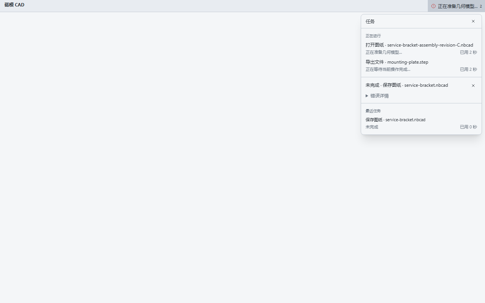

# Runtime Activity and ordinary launch reuse

The floating startup card belongs to application initialization. Successful startup latches completion for that window; later Open, import, export, save, geometry, drawing, and CAM work use the compact top-bar **Activity** indicator. Opening its panel shows named operations, their real phase, elapsed time, recent results, and copyable error details. The canvas remains available subject to the existing CAD operation guards.

The indicator appears immediately. Details wait 300 ms to avoid flicker for short work. There are no invented percentages or cancellation controls. Abandoned pickers and superseded jobs retire silently. Completion and failure notifications remain in Activity until dismissed; recent history and notification counts are bounded. English, Simplified Chinese, Spanish, and German use the existing locale preference and fallback rules.

File loading is separate from application loading. Open reports file reading/validation, geometry preparation, adoption, and rendering. In the native 3D workspace it completes only after the required current model revision and viewport extent produce a newer presented frame. Drawing projection and CAM retain their existing ownership and task infrastructure. Geometry computation feedback does not claim that a frame has already been presented.

Ordinary launches bring the existing window forward. Forwarded file opens wait for application readiness and existing operation guards, then use the normal unsaved-change prompt. A document ownership check at replacement prevents earlier consent from overwriting newer edits or a different tab. Recipe links open editable source; they do not execute code. **File → New Window** and `--new-window` explicitly create another window.

The launch broker uses safe Rust, an OS-held file lock, an authenticated bounded loopback request, retained pending requests, and acknowledgements after frontend handling. Executable identity and diagnostic/profile namespaces isolate development and private verification from an installed user application. Private profiles and startup reports normally bypass reuse; `--reuse-window` explicitly enables reuse within that same private namespace for testing. Failed delivery falls back to an independent launch rather than dropping a requested file.

## Verification and reproduction

Frontend checks:

```powershell
npm run test:frontend
npx tsc --noEmit
npm run build:desktop
```

`test:startup` includes one-way readiness, runtime task ownership, silent abandonment, durable failure results, nested/concurrent geometry work, document frame ownership, and four-locale copy checks. The browser ownership check in `src/files/openConsent.browser.test.ts` exercises the production Open path with held file IPC: both a new edit and a tab replacement reject stale consent before any native model replacement.

Native library verification passed **130 tests**, with six existing intentionally ignored tests. The new tests cover launch parsing, queue retention/bounds/deduplication, authentication, lock release, and identity isolation. Build with the repository's checked OCCT SDK and Cargo environment described in [the startup report](startup-performance.md); use `cargo test --manifest-path src-tauri/Cargo.toml --lib` with the Windows Common Controls manifest required by the existing native harness.

The [four localized Activity captures](startup-measurements/captures/runtime/layout-checks.json) use the actual component and simulated named operations, not native timing measurements. All fit a 1280×800 viewport without horizontal overflow; Escape dismisses the panel and runtime feedback does not mount the startup card. The English check also passed both held-file ownership cases.




Existing before/after startup timings and the real native loading GIF remain documented in [startup-performance.md](startup-performance.md) and [startup-gallery.md](startup-gallery.md). Those timings identify their own executable and cache conditions; they are not new measurements of this runtime extension.

## Windows functional verification

Verified on Thunder using the final executable SHA256 `996bb2421ed459296125725bdf89209c4cfb3848e23ae12091465facc345062f` and embedded frontend SHA256 `1c7950db034ebad69f4c682d27fbf11c32da665aac02b7d11c59891ea7b3952a`:

- Empty startup reaches the normal workspace; an early forwarded sample request is retained and renders all four sample history entries in that same window.
- Ordinary relaunch exits the secondary launcher and brings the original window forward. **File → New Window** creates an independent empty workspace; another ordinary launch still targets the original owner.
- Activity opens over the rendered sample, Escape dismisses it, and the toolbar button regains visible focus. CAD capture-phase shortcuts yield to the focused Activity panel.
- A missing-file request produces the existing useful error dialog and durable, expandable Activity details. The sample remains rendered and the startup card stays absent.

The preceding executable SHA256 `d98babc79d944be47c1982494bdf08644859111a3a22a3adffc79b158876a2dd` verified forwarded-open **Save / Don't Save / Cancel** prompting, Cancel preserving a private unsaved rename, and front-view interaction. The final change only isolates Activity keyboard routing; the native broker and document implementation are unchanged. The private verification processes were closed; installed user application windows were preserved.

For a repeatable private paired-launch check, use the same executable path and profile for both calls:

```powershell
$env:PATH = 'D:\limo-cad-maintenance\checked-occt-sdk\bin;' + $env:PATH
$env:WEBVIEW2_USER_DATA_FOLDER = 'D:\limo-runtime-check\webview2'
$app = 'D:\limo-startup-candidate-runtime-activity-keyboard-final\LimoRuntimeActivityKeyboardFinal.exe'
Start-Process $app -ArgumentList '--reuse-window'
# Wait for the workspace, then repeat: the existing window comes forward.
Start-Process $app -ArgumentList '--reuse-window'
# Forward a repository sample to that existing window.
Start-Process $app -ArgumentList @('--reuse-window', (Resolve-Path examples/testPiece.nbcad).Path)
# The explicit action creates a separate window.
Start-Process $app -ArgumentList '--new-window'
```

These child-launch checks are functional evidence, not a new cold-start benchmark. Other unrelated build/application work was active on Thunder, so their launcher durations are not promoted to performance results.


