# Limo CAD startup visual review

The floating card is 560 × 380 logical pixels. Shared artwork contains no text;
names, status, document progress, notes and recovery controls use the selected
language. English mode is entirely English. The card dismisses on successful
required initialization and rendering, without a mandatory animation or delay.

## English design examples

These are selected states of the actual React component, captured with simulated
native IPC. They demonstrate layout and copy, not measured startup duration.

Preparing the first view, with one stationary workshop note:

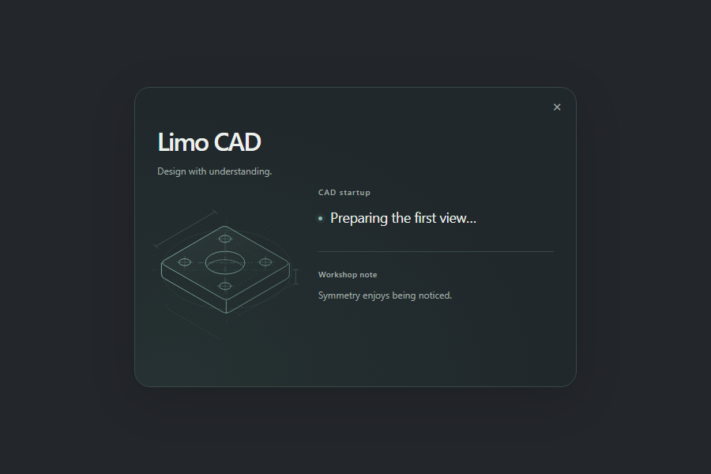

GPU preparation:

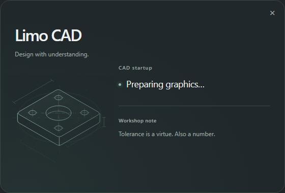

CAD initialization and file geometry preparation are independent:

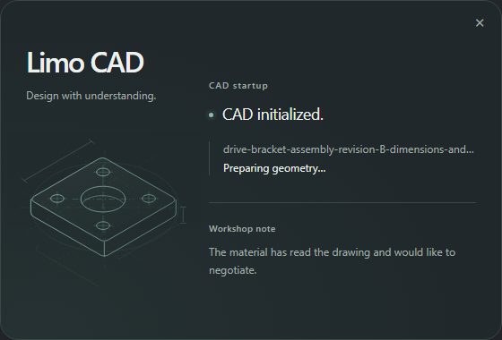

Light appearance:

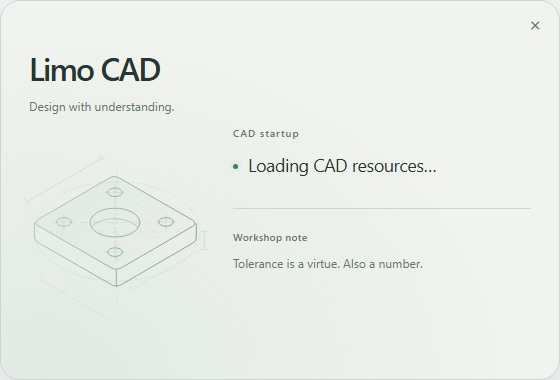

Recovery keeps details and actions available:

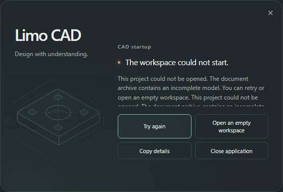

## Companion view in four languages

The same graphics-preparation phase, artwork and layout:

English — Limo CAD:

Simplified Chinese — 砺模 CAD:

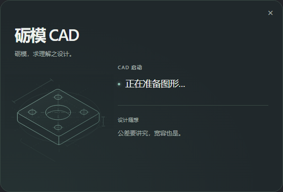

Spanish — Limo CAD:

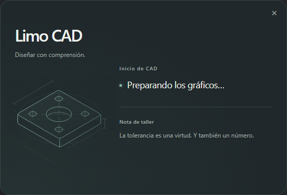

German — Limo CAD:

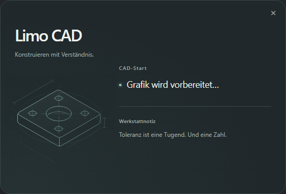

## Actual Windows frames

Recorded native loading on Thunder, from opening feedback through workspace
reveal. These are sampled window-only screenshots of a normal empty launch in
a private fresh profile, not a performance benchmark. The small card is centered
on a neutral canvas and the workspace is scaled to fit; the final workspace has
a one-second presentation hold before the loop restarts.

Playback at the observed sample spacing:

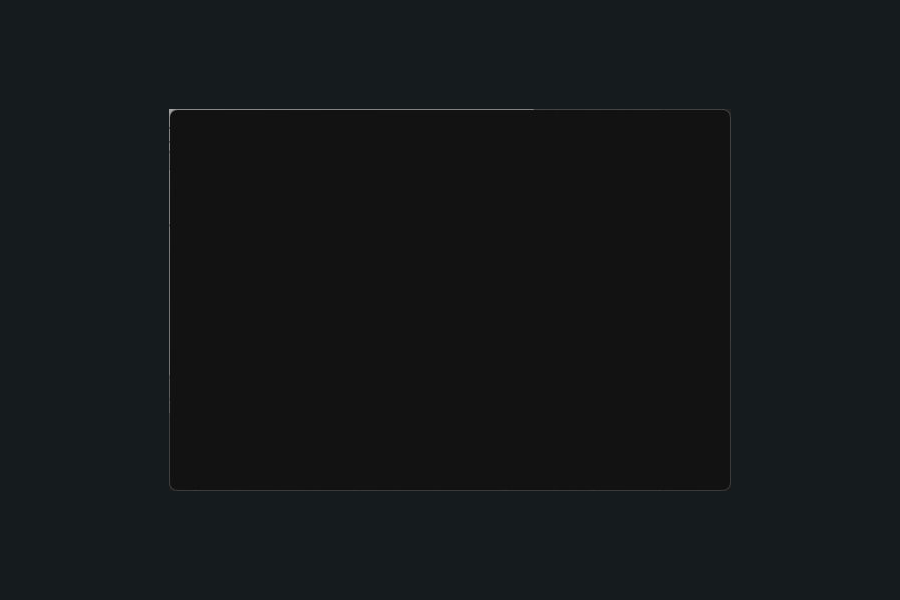

The same recording at one-third speed, to make short phases easier to read:

The [recording receipt](startup-measurements/captures/floating/native-loading-recording.json)
retains the source executable hash, frame dimensions, sample intervals and GIF
playback delays. Startup timings come from separate unrecorded runs.

These captures came from the native application, using an isolated profile and
private failure fixture. Recovery includes deliberate human/automation waits;
the images do not encode measured timing.

Final native executable, loading without the Windows title bar:

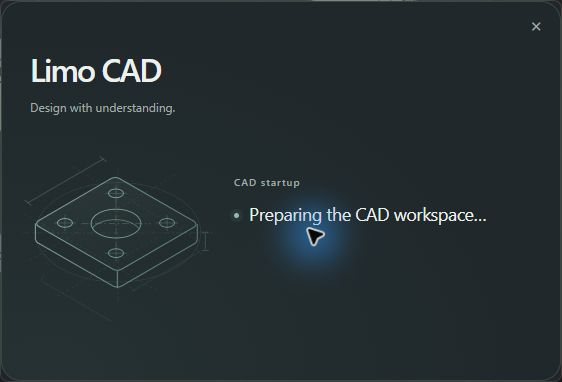

Recoverable invalid project:

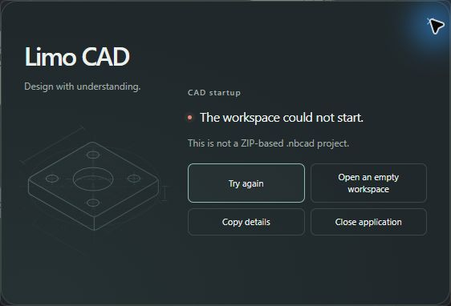

After repairing the private fixture and retrying in the same process, the sample
renders with its four history entries and normal workspace controls return:

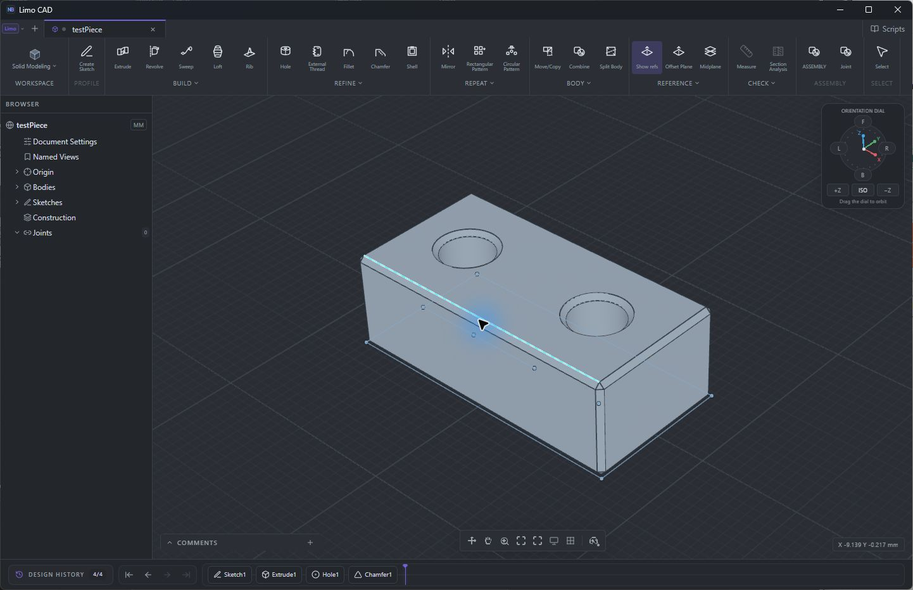

The native front-view control changes the rendered sample:

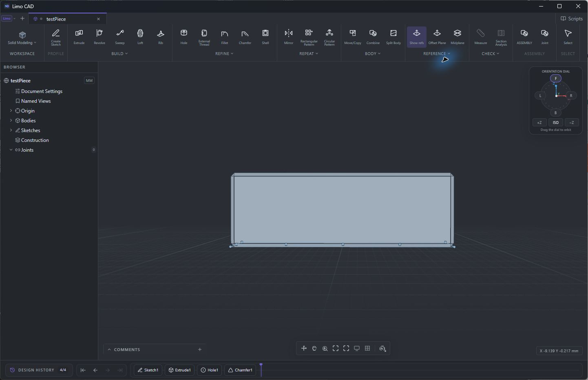

Regional glyphs and recovery in the earlier floating executable's native Chinese
card (the report preserves its distinct executable hash):

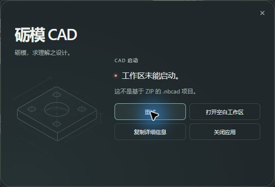

See [measurements and verification](startup-performance.md) for executable hashes,
cache conditions, timing scopes, reproduction commands and outstanding checks.
